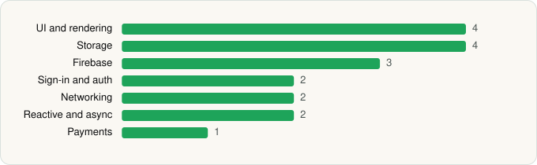

<picture><source media="(prefers-color-scheme: dark)" srcset="../../../../assets/logo/logo-dark.svg"></picture> [Tech Stack](../../../../README.md) / [DuckDuckGo](../../../../companies/duckduckgo.md) / DuckDuckGo, optional Duck.ai

# DuckDuckGo, optional Duck.ai

<picture><source media="(prefers-color-scheme: dark)" srcset="../../../../assets/badges/android-dark.svg"></picture> <picture><source media="(prefers-color-scheme: dark)" srcset="../../../../assets/badges/active-dark.svg"></picture>

[Google Play](https://play.google.com/store/apps/details?id=com.duckduckgo.mobile.android) · [latest.json](latest.json)

| | |
|---|---|
| Company | [DuckDuckGo](../../../../companies/duckduckgo.md) |
| Store id | `com.duckduckgo.mobile.android` |
| Bundle / package id | `com.duckduckgo.mobile.android` |
| Latest version | 5.299.0 (analysed 2026-10-23) |
| Versions tracked | 3 |
| SDKs in latest version | 18 |
| Languages | C/C++ (native), Java, Kotlin |
| UI | Glide, Jetpack Compose, Lottie, Material Components |
| Build | Gradle (inferred) |
| Minimum OS | API 29, targets API 36 |
| Devices / ABIs | Android |
| Capabilities | 13 |
| Declares tracking | No |
| Tracked | Yes |

## SDKs by category

<picture><source media="(prefers-color-scheme: dark)" srcset="../../../../assets/charts/apps/android/duckduckgo/duckduckgo-optional-duck-ai-dark.svg"></picture>

- **UI and rendering** (4): Glide, Jetpack Compose, Lottie, Material Components
- **Storage** (4): DataStore, Okio, Room, SQLCipher
- **Firebase** (3): Firebase, Google DataTransport, Google Play services
- **Sign-in and auth** (2): Credential Manager, Google Sign-In / Auth
- **Networking** (2): OkHttp, Retrofit
- **Reactive and async** (2): Kotlin Coroutines, RxJava
- **Payments** (1): Google Play Billing

Capabilities (13)

Approximate location, Biometric auth, Camera, Fingerprint auth, Foreground service, Foreground service: microphone, Install other apps, Microphone, Notifications, Phone / carrier info, Precise location, Query all installed apps, Storage (write)

## Version history

| Version | Analysed | Store update | SDKs | Change | SDK list is a floor | Binary encrypted | File |
|---|---|---|---|---|---|---|---|
| 5.299.0 | 2026-10-23 | 2026-10-19 | 18 | +1 / −2 | No | No | [5.299.0.json](5.299.0.json) |
| 5.283.1 | 2026-06-19 |  | 19 | +0 / −0 | No | No | [5.283.1.json](5.283.1.json) |
| 5.282.0 | 2026-06-11 |  | 19 |  | No | No | [5.282.0.json](5.282.0.json) |

### SDK changes between versions

- 5.283.1 → 5.299.0: added Credential Manager; removed Coil, Google Location

---

Generated by `scripts/build_readme.py` from the JSON files. Do not edit by hand.
