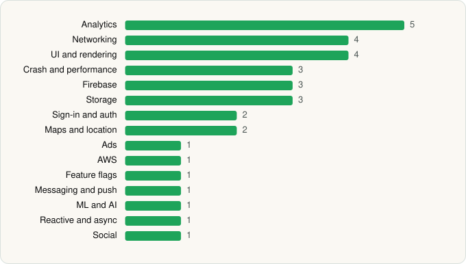

<picture><source media="(prefers-color-scheme: dark)" srcset="../../../../assets/logo/logo-dark.svg"></picture> [Tech Stack](../../../../README.md) / [Dunkin' Brands, Inc.](../../../../companies/dunkin-brands-inc.md) / Dunkin’

# Dunkin’

<picture><source media="(prefers-color-scheme: dark)" srcset="../../../../assets/badges/android-dark.svg"></picture> <picture><source media="(prefers-color-scheme: dark)" srcset="../../../../assets/badges/inactive-dark.svg"></picture>

[Google Play](https://play.google.com/store/apps/details?id=com.dunkinbrands.otgo) · [latest.json](latest.json)

| | |
|---|---|
| Company | [Dunkin' Brands, Inc.](../../../../companies/dunkin-brands-inc.md) |
| Store id | `com.dunkinbrands.otgo` |
| Bundle / package id | `com.dunkinbrands.otgo` |
| Latest version | 11.8.0.358 (analysed 2026-06-22) |
| Versions tracked | 1 |
| SDKs in latest version | 33 |
| Languages | C/C++ (native), Java, Kotlin |
| UI | Glide, Lottie, Material Components |
| Build | Gradle (inferred) |
| Minimum OS | API 28, targets API 34 |
| Devices / ABIs | Android |
| Capabilities | 13 |
| Declares tracking | Yes |
| Tracked | No. Kept for history. |

## SDKs by category

<picture><source media="(prefers-color-scheme: dark)" srcset="../../../../assets/charts/apps/android/dunkin-brands-inc/dunkin-dark.svg"></picture>

- **Analytics** (5): Branch, Facebook SDK, Firebase Analytics, Flurry, Google App Measurement
- **Networking** (4): Ktor, OkHttp, Retrofit, Volley
- **UI and rendering** (4): AndroidSVG, Glide, Lottie, Material Components
- **Crash and performance** (3): Firebase Crashlytics, Firebase Performance, New Relic
- **Firebase** (3): Firebase, Google DataTransport, Google Play services
- **Storage** (3): DataStore, Okio, Room
- **Sign-in and auth** (2): Facebook Login, Google Sign-In / Auth
- **Maps and location** (2): Google Location, Google Maps
- **Ads** (1): Google Mobile Ads (AdMob)
- **AWS** (1): AWS SDK
- **Feature flags** (1): Firebase Remote Config
- **Messaging and push** (1): Firebase Messaging
- **ML and AI** (1): OpenCV
- **Reactive and async** (1): Kotlin Coroutines
- **Social** (1): Facebook Share

Capabilities (13)

Advertising ID, Approximate location, Background location, Biometric auth, Bluetooth, Camera, Contacts (read), Fingerprint auth, Foreground service, Foreground service: location, Notifications, Precise location, Storage (write)

## Version history

| Version | Analysed | Store update | SDKs | Change | SDK list is a floor | Binary encrypted | File |
|---|---|---|---|---|---|---|---|
| 11.8.0.358 | 2026-06-22 |  | 33 |  | No | No | [11.8.0.358.json](11.8.0.358.json) |

---

Generated by `scripts/build_readme.py` from the JSON files. Do not edit by hand.
