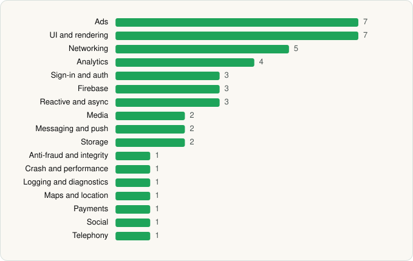

<picture><source media="(prefers-color-scheme: dark)" srcset="../../../../assets/logo/logo-dark.svg"></picture> [Tech Stack](../../../../README.md) / [Duolingo](../../../../companies/duolingo.md) / Duolingo

# Duolingo: Learn Languages

<picture><source media="(prefers-color-scheme: dark)" srcset="../../../../assets/badges/android-dark.svg"></picture> <picture><source media="(prefers-color-scheme: dark)" srcset="../../../../assets/badges/active-dark.svg"></picture>

[Google Play](https://play.google.com/store/apps/details?id=com.duolingo) · [latest.json](latest.json)

| | |
|---|---|
| Company | [Duolingo](../../../../companies/duolingo.md) |
| Store id | `com.duolingo` |
| Bundle / package id | `com.duolingo` |
| Latest version | 6.102.4 (analysed 2026-10-24) |
| Versions tracked | 1 |
| SDKs in latest version | 45 |
| Languages | C/C++ (native), Java, Kotlin, Unity (C# / IL2CPP) |
| UI | Coil, Jetpack Compose, Lottie, Material Components, Picasso, Rive |
| Build | Gradle (inferred) |
| Minimum OS | API 29, targets API 36 |
| Devices / ABIs | Android |
| Capabilities | 11 |
| Declares tracking | Yes |
| Tracked | Yes |

## SDKs by category

<picture><source media="(prefers-color-scheme: dark)" srcset="../../../../assets/charts/apps/android/duolingo/duolingo-dark.svg"></picture>

- **Ads** (7): Google Ad Manager, Google Mobile Ads (AdMob), ironSource, Meta Audience Network, Pangle, Unity Ads, Vungle
- **UI and rendering** (7): AndroidSVG, Coil, Jetpack Compose, Lottie, Material Components, Picasso, Rive
- **Networking** (5): Cronet, Cronet (Google), Ktor, OkHttp, Volley
- **Analytics** (4): Adjust, Facebook SDK, Firebase Analytics, Google App Measurement
- **Sign-in and auth** (3): Credential Manager, Facebook Login, Google Sign-In / Auth
- **Firebase** (3): Firebase, Google DataTransport, Google Play services
- **Reactive and async** (3): Kotlin Coroutines, RxJava, RxJava 3
- **Media** (2): ExoPlayer, Media3 (ExoPlayer)
- **Messaging and push** (2): Firebase Messaging, Zendesk
- **Storage** (2): DataStore, Room
- **Anti-fraud and integrity** (1): Play Integrity
- **Crash and performance** (1): Sentry
- **Logging and diagnostics** (1): LeakCanary
- **Maps and location** (1): Google Location
- **Payments** (1): Google Play Billing
- **Social** (1): Facebook Share
- **Telephony** (1): libphonenumber

Capabilities (11)

Advertising ID, Biometric auth, Calendar (read), Calendar (write), Contacts (read), Fingerprint auth, Foreground service, Microphone, Notifications, Storage (read), Storage (write)

## Version history

| Version | Analysed | Store update | SDKs | Change | SDK list is a floor | Binary encrypted | File |
|---|---|---|---|---|---|---|---|
| 6.102.4 | 2026-10-24 |  | 45 |  | No | No | [6.102.4.json](6.102.4.json) |

---

Generated by `scripts/build_readme.py` from the JSON files. Do not edit by hand.
