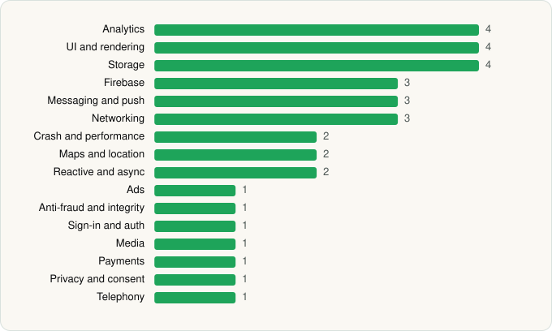

<picture><source media="(prefers-color-scheme: dark)" srcset="../../../../assets/logo/logo-dark.svg"></picture> [Tech Stack](../../../../README.md) / [GOAT](../../../../companies/goat.md) / GOAT

# GOAT – Sneakers & Apparel

<picture><source media="(prefers-color-scheme: dark)" srcset="../../../../assets/badges/android-dark.svg"></picture> <picture><source media="(prefers-color-scheme: dark)" srcset="../../../../assets/badges/active-dark.svg"></picture>

[Google Play](https://play.google.com/store/apps/details?id=com.airgoat.goat) · [latest.json](latest.json)

| | |
|---|---|
| Company | [GOAT](../../../../companies/goat.md) |
| Store id | `com.airgoat.goat` |
| Bundle / package id | `com.airgoat.goat` |
| Latest version | 2.11.0 (analysed 2026-06-19) |
| Versions tracked | 1 |
| SDKs in latest version | 34 |
| Languages | C/C++ (native), Java, Kotlin |
| UI | Coil, Glide, Jetpack Compose, Material Components |
| Build | Gradle (inferred) |
| Minimum OS | API 29, targets API 36 |
| Devices / ABIs | Android |
| Capabilities | 5 |
| Declares tracking | Yes |
| Tracked | Yes |

## SDKs by category

<picture><source media="(prefers-color-scheme: dark)" srcset="../../../../assets/charts/apps/android/goat/goat-dark.svg"></picture>

- **Analytics** (4): AppsFlyer, Branch, Firebase Analytics, Google Analytics (legacy)
- **UI and rendering** (4): Coil, Glide, Jetpack Compose, Material Components
- **Storage** (4): DataStore, Okio, Room, SQLDelight
- **Firebase** (3): Firebase, Google DataTransport, Google Play services
- **Messaging and push** (3): Braze, Firebase Messaging, Zendesk
- **Networking** (3): Ktor, OkHttp, Retrofit
- **Crash and performance** (2): Embrace, OpenTelemetry
- **Maps and location** (2): Google Location, Google Maps
- **Reactive and async** (2): Kotlin Coroutines, RxJava
- **Ads** (1): Google Mobile Ads (AdMob)
- **Anti-fraud and integrity** (1): Play Integrity
- **Sign-in and auth** (1): Google Sign-In / Auth
- **Media** (1): Media3 (ExoPlayer)
- **Payments** (1): Stripe
- **Privacy and consent** (1): OneTrust
- **Telephony** (1): libphonenumber

Capabilities (5)

Advertising ID, Approximate location, Camera, Foreground service, Notifications

## Version history

| Version | Analysed | Store update | SDKs | Change | SDK list is a floor | Binary encrypted | File |
|---|---|---|---|---|---|---|---|
| 2.11.0 | 2026-06-19 |  | 34 |  | No | No | [2.11.0.json](2.11.0.json) |

---

Generated by `scripts/build_readme.py` from the JSON files. Do not edit by hand.
