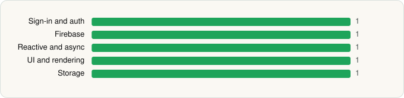

<picture><source media="(prefers-color-scheme: dark)" srcset="../../../../assets/logo/logo-dark.svg"></picture> [Tech Stack](../../../../README.md) / [Google LLC](../../../../companies/google-llc.md) / Google Gemini

# Google Gemini

<picture><source media="(prefers-color-scheme: dark)" srcset="../../../../assets/badges/android-dark.svg"></picture> <picture><source media="(prefers-color-scheme: dark)" srcset="../../../../assets/badges/active-dark.svg"></picture>

[Google Play](https://play.google.com/store/apps/details?id=com.google.android.apps.bard) · [latest.json](latest.json)

| | |
|---|---|
| Company | [Google LLC](../../../../companies/google-llc.md) |
| Store id | `com.google.android.apps.bard` |
| Bundle / package id | `com.google.android.apps.bard` |
| Latest version | 1.0.995038376 (analysed 2026-10-23) |
| Versions tracked | 1 |
| SDKs in latest version | 5 |
| Languages | C/C++ (native), Java, Kotlin |
| UI | Material Components |
| Build | Gradle (inferred) |
| Minimum OS | API 29, targets API 37 |
| Devices / ABIs | Android |
| Capabilities | 0 |
| Declares tracking | No |
| Tracked | Yes |

## SDKs by category

<picture><source media="(prefers-color-scheme: dark)" srcset="../../../../assets/charts/apps/android/google-llc/gemini-dark.svg"></picture>

- **Sign-in and auth** (1): Google Sign-In / Auth
- **Firebase** (1): Google Play services
- **Reactive and async** (1): Kotlin Coroutines
- **UI and rendering** (1): Material Components
- **Storage** (1): Room

## Version history

| Version | Analysed | Store update | SDKs | Change | SDK list is a floor | Binary encrypted | File |
|---|---|---|---|---|---|---|---|
| 1.0.995038376 | 2026-10-23 | 2026-10-13 | 5 |  | No | No | [1.0.995038376.json](1.0.995038376.json) |

---

Generated by `scripts/build_readme.py` from the JSON files. Do not edit by hand.
