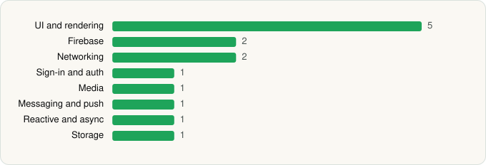

<picture><source media="(prefers-color-scheme: dark)" srcset="../../../../assets/logo/logo-dark.svg"></picture> [Tech Stack](../../../../README.md) / [Google LLC](../../../../companies/google-llc.md) / Google Chat

# Google Chat

<picture><source media="(prefers-color-scheme: dark)" srcset="../../../../assets/badges/android-dark.svg"></picture> <picture><source media="(prefers-color-scheme: dark)" srcset="../../../../assets/badges/active-dark.svg"></picture>

[Google Play](https://play.google.com/store/apps/details?id=com.google.android.apps.dynamite) · [latest.json](latest.json)

| | |
|---|---|
| Company | [Google LLC](../../../../companies/google-llc.md) |
| Store id | `com.google.android.apps.dynamite` |
| Bundle / package id | `com.google.android.apps.dynamite` |
| Latest version | 2026.05.25.920828381.Release (analysed 2026-06-19) |
| Versions tracked | 1 |
| SDKs in latest version | 14 |
| Languages | C/C++ (native), Java, Kotlin |
| UI | Coil, Glide, Jetpack Compose, Lottie, Material Components |
| Build | Gradle (inferred) |
| Minimum OS | API 23, targets API 37 |
| Devices / ABIs | Android |
| Capabilities | 6 |
| Declares tracking | No |
| Tracked | Yes |

## SDKs by category

<picture><source media="(prefers-color-scheme: dark)" srcset="../../../../assets/charts/apps/android/google-llc/google-chat-dark.svg"></picture>

- **UI and rendering** (5): Coil, Glide, Jetpack Compose, Lottie, Material Components
- **Firebase** (2): Firebase, Google Play services
- **Networking** (2): Cronet, Cronet (Google)
- **Sign-in and auth** (1): Google Sign-In / Auth
- **Media** (1): Media3 (ExoPlayer)
- **Messaging and push** (1): Firebase Messaging
- **Reactive and async** (1): Kotlin Coroutines
- **Storage** (1): Room

Capabilities (6)

Camera, Contacts (read), Foreground service, Microphone, Notifications, Storage (write)

## Version history

| Version | Analysed | Store update | SDKs | Change | SDK list is a floor | Binary encrypted | File |
|---|---|---|---|---|---|---|---|
| 2026.05.25.920828381.Release | 2026-06-19 |  | 14 |  | No | No | [2026.05.25.920828381.Release.json](2026.05.25.920828381.Release.json) |

---

Generated by `scripts/build_readme.py` from the JSON files. Do not edit by hand.
