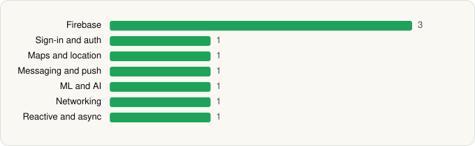

<picture><source media="(prefers-color-scheme: dark)" srcset="../../../../assets/logo/logo-dark.svg"></picture> [Tech Stack](../../../../README.md) / [Google LLC](../../../../companies/google-llc.md) / Google Chrome

# Google Chrome

<picture><source media="(prefers-color-scheme: dark)" srcset="../../../../assets/badges/android-dark.svg"></picture> <picture><source media="(prefers-color-scheme: dark)" srcset="../../../../assets/badges/inactive-dark.svg"></picture>

[Google Play](https://play.google.com/store/apps/details?id=com.android.chrome) · [latest.json](latest.json)

| | |
|---|---|
| Company | [Google LLC](../../../../companies/google-llc.md) |
| Store id | `com.android.chrome` |
| Bundle / package id | `com.android.chrome` |
| Latest version | 148.0.7778.217 (analysed 2026-06-23) |
| Versions tracked | 1 |
| SDKs in latest version | 9 |
| Languages | C/C++ (native), Java, Kotlin |
| UI | Android Views (inferred) |
| Build | Gradle (inferred) |
| Minimum OS | API 29, targets API 36 |
| Devices / ABIs | Android |
| Capabilities | 13 |
| Declares tracking | Yes |
| Tracked | No. Kept for history. |

## SDKs by category

<picture><source media="(prefers-color-scheme: dark)" srcset="../../../../assets/charts/apps/android/google-llc/google-chrome-dark.svg"></picture>

- **Firebase** (3): Firebase, Google DataTransport, Google Play services
- **Sign-in and auth** (1): Google Sign-In / Auth
- **Maps and location** (1): Google Maps
- **Messaging and push** (1): Firebase Messaging
- **ML and AI** (1): Mobile Vision
- **Networking** (1): Cronet
- **Reactive and async** (1): Kotlin Coroutines

Capabilities (13)

Approximate location, Camera, Foreground service, Foreground service: camera, Foreground service: media playback, Foreground service: microphone, Microphone, NFC, Notifications, Precise location, Query all installed apps, Storage (read), Storage (write)

## Version history

| Version | Analysed | Store update | SDKs | Change | SDK list is a floor | Binary encrypted | File |
|---|---|---|---|---|---|---|---|
| 148.0.7778.217 | 2026-06-23 |  | 9 |  | No | No | [148.0.7778.217.json](148.0.7778.217.json) |

## Model-written summary

> Chromium-based Android browser with native C/C++ core, Cronet networking, 58 services, and deep Google SDK integration

Written by a language model from the detected signals (`inferred[]`). It is commentary, not measurement.

---

Generated by `scripts/build_readme.py` from the JSON files. Do not edit by hand.
