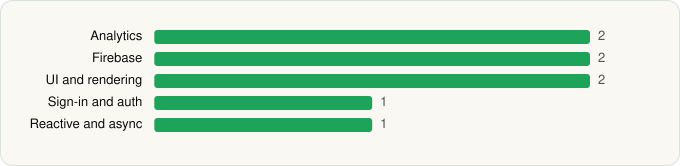

<picture><source media="(prefers-color-scheme: dark)" srcset="../../../../assets/logo/logo-dark.svg"></picture> [Tech Stack](../../../../README.md) / [Google LLC](../../../../companies/google-llc.md) / Google Lens

# Google Lens

<picture><source media="(prefers-color-scheme: dark)" srcset="../../../../assets/badges/android-dark.svg"></picture> <picture><source media="(prefers-color-scheme: dark)" srcset="../../../../assets/badges/active-dark.svg"></picture>

[Google Play](https://play.google.com/store/apps/details?id=com.google.ar.lens) · [latest.json](latest.json)

| | |
|---|---|
| Company | [Google LLC](../../../../companies/google-llc.md) |
| Store id | `com.google.ar.lens` |
| Bundle / package id | `com.google.ar.lens` |
| Latest version | 1.18.250731009 (analysed 2026-06-19) |
| Versions tracked | 1 |
| SDKs in latest version | 8 |
| Languages | C/C++ (native), Java, Kotlin |
| UI | Glide, Material Components |
| Build | Gradle (inferred) |
| Minimum OS | API 23, targets API 36 |
| Devices / ABIs | Android |
| Capabilities | 1 |
| Declares tracking | Yes |
| Tracked | Yes |

## SDKs by category

<picture><source media="(prefers-color-scheme: dark)" srcset="../../../../assets/charts/apps/android/google-llc/google-lens-dark.svg"></picture>

- **Analytics** (2): Firebase Analytics, Google App Measurement
- **Firebase** (2): Firebase, Google Play services
- **UI and rendering** (2): Glide, Material Components
- **Sign-in and auth** (1): Google Sign-In / Auth
- **Reactive and async** (1): Kotlin Coroutines

Capabilities (1)

Advertising ID

## Version history

| Version | Analysed | Store update | SDKs | Change | SDK list is a floor | Binary encrypted | File |
|---|---|---|---|---|---|---|---|
| 1.18.250731009 | 2026-06-19 |  | 8 |  | No | No | [1.18.250731009.json](1.18.250731009.json) |

---

Generated by `scripts/build_readme.py` from the JSON files. Do not edit by hand.
