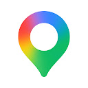
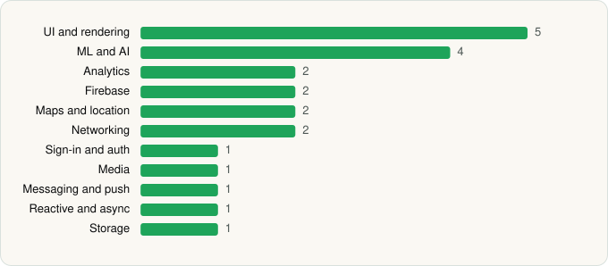

<picture><source media="(prefers-color-scheme: dark)" srcset="../../../../assets/logo/logo-dark.svg"></picture> [Tech Stack](../../../../README.md) / [Google LLC](../../../../companies/google-llc.md) / Google Maps

# Google Maps

<picture><source media="(prefers-color-scheme: dark)" srcset="../../../../assets/badges/android-dark.svg"></picture> <picture><source media="(prefers-color-scheme: dark)" srcset="../../../../assets/badges/inactive-dark.svg"></picture>

[Google Play](https://play.google.com/store/apps/details?id=com.google.android.apps.maps) · [latest.json](latest.json)

| | |
|---|---|
| Company | [Google LLC](../../../../companies/google-llc.md) |
| Store id | `com.google.android.apps.maps` |
| Bundle / package id | `com.google.android.apps.maps` |
| Latest version | 26.22.04.920688788 (analysed 2026-06-19) |
| Versions tracked | 1 |
| SDKs in latest version | 22 |
| Languages | C/C++ (native), Java, Kotlin |
| UI | Coil, Glide, Jetpack Compose, Lottie, Material Components |
| Build | Gradle (inferred) |
| Minimum OS | API 28, targets API 37 |
| Devices / ABIs | Android |
| Capabilities | 16 |
| Declares tracking | Yes |
| Tracked | No. Kept for history. |

## SDKs by category

<picture><source media="(prefers-color-scheme: dark)" srcset="../../../../assets/charts/apps/android/google-llc/google-maps-dark.svg"></picture>

- **UI and rendering** (5): Coil, Glide, Jetpack Compose, Lottie, Material Components
- **ML and AI** (4): ML Kit, Mobile Vision, TensorFlow, TensorFlow Lite
- **Analytics** (2): Firebase Analytics, Google App Measurement
- **Firebase** (2): Firebase, Google Play services
- **Maps and location** (2): Google Location, Google Maps
- **Networking** (2): Cronet, Cronet (Google)
- **Sign-in and auth** (1): Google Sign-In / Auth
- **Media** (1): Media3 (ExoPlayer)
- **Messaging and push** (1): Firebase Messaging
- **Reactive and async** (1): Kotlin Coroutines
- **Storage** (1): Room

Capabilities (16)

Activity / fitness recognition, Advertising ID, Approximate location, Background location, Camera, Contacts (read), Foreground service, Foreground service: location, Media: images, Media: video, Microphone, NFC, Notifications, Precise location, Storage (read), Storage (write)

## Version history

| Version | Analysed | Store update | SDKs | Change | SDK list is a floor | Binary encrypted | File |
|---|---|---|---|---|---|---|---|
| 26.22.04.920688788 | 2026-06-19 |  | 22 |  | No | No | [26.22.04.920688788.json](26.22.04.920688788.json) |

---

Generated by `scripts/build_readme.py` from the JSON files. Do not edit by hand.
