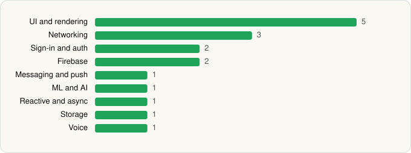

<picture><source media="(prefers-color-scheme: dark)" srcset="../../../../assets/logo/logo-dark.svg"></picture> [Tech Stack](../../../../README.md) / [Google LLC](../../../../companies/google-llc.md) / Google Meet

# Google Meet

<picture><source media="(prefers-color-scheme: dark)" srcset="../../../../assets/badges/android-dark.svg"></picture> <picture><source media="(prefers-color-scheme: dark)" srcset="../../../../assets/badges/active-dark.svg"></picture>

[Google Play](https://play.google.com/store/apps/details?id=com.google.android.apps.tachyon) · [latest.json](latest.json)

| | |
|---|---|
| Company | [Google LLC](../../../../companies/google-llc.md) |
| Store id | `com.google.android.apps.tachyon` |
| Bundle / package id | `com.google.android.apps.tachyon` |
| Latest version | 362.0.924540007.duo.android_20260601.01_p0 (analysed 2026-06-19) |
| Versions tracked | 1 |
| SDKs in latest version | 17 |
| Languages | C/C++ (native), Java, Kotlin |
| UI | Coil, Glide, Jetpack Compose, Lottie, Material Components |
| Build | Gradle (inferred) |
| Minimum OS | API 23, targets API 37 |
| Devices / ABIs | Android |
| Capabilities | 12 |
| Declares tracking | Yes |
| Tracked | Yes |

## SDKs by category

<picture><source media="(prefers-color-scheme: dark)" srcset="../../../../assets/charts/apps/android/google-llc/google-meet-dark.svg"></picture>

- **UI and rendering** (5): Coil, Glide, Jetpack Compose, Lottie, Material Components
- **Networking** (3): Cronet, Cronet (Chromium net), Cronet (Google)
- **Sign-in and auth** (2): AppAuth, Google Sign-In / Auth
- **Firebase** (2): Firebase, Google Play services
- **Messaging and push** (1): Firebase Messaging
- **ML and AI** (1): ML Kit
- **Reactive and async** (1): Kotlin Coroutines
- **Storage** (1): Room
- **Voice** (1): WebRTC

Capabilities (12)

Bluetooth, Bluetooth (connect), Camera, Contacts (read), Contacts (write), Foreground service, Foreground service: camera, Foreground service: media playback, Foreground service: microphone, Microphone, Notifications, Phone / carrier info

## Version history

| Version | Analysed | Store update | SDKs | Change | SDK list is a floor | Binary encrypted | File |
|---|---|---|---|---|---|---|---|
| 362.0.924540007.duo.android_20260601.01_p0 | 2026-06-19 |  | 17 |  | No | No | [362.0.924540007.duo.android_20260601.01_p0.json](362.0.924540007.duo.android_20260601.01_p0.json) |

---

Generated by `scripts/build_readme.py` from the JSON files. Do not edit by hand.
