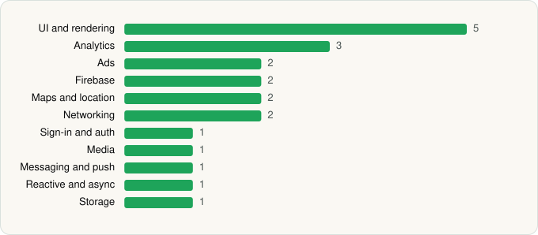

<picture><source media="(prefers-color-scheme: dark)" srcset="../../../../assets/logo/logo-dark.svg"></picture> [Tech Stack](../../../../README.md) / [Google LLC](../../../../companies/google-llc.md) / Google News

# Google News - Daily Headlines

<picture><source media="(prefers-color-scheme: dark)" srcset="../../../../assets/badges/android-dark.svg"></picture> <picture><source media="(prefers-color-scheme: dark)" srcset="../../../../assets/badges/active-dark.svg"></picture>

[Google Play](https://play.google.com/store/apps/details?id=com.google.android.apps.magazines) · [latest.json](latest.json)

| | |
|---|---|
| Company | [Google LLC](../../../../companies/google-llc.md) |
| Store id | `com.google.android.apps.magazines` |
| Bundle / package id | `com.google.android.apps.magazines` |
| Latest version | 5.159.0.914722252 (analysed 2026-06-19) |
| Versions tracked | 1 |
| SDKs in latest version | 21 |
| Languages | C/C++ (native), Java, Kotlin |
| UI | Coil, Glide, Jetpack Compose, Lottie, Material Components |
| Build | Gradle (inferred) |
| Minimum OS | API 24, targets API 37 |
| Devices / ABIs | Android |
| Capabilities | 5 |
| Declares tracking | Yes |
| Tracked | Yes |

## SDKs by category

<picture><source media="(prefers-color-scheme: dark)" srcset="../../../../assets/charts/apps/android/google-llc/google-news-dark.svg"></picture>

- **UI and rendering** (5): Coil, Glide, Jetpack Compose, Lottie, Material Components
- **Analytics** (3): Firebase Analytics, Google Analytics (legacy), Google App Measurement
- **Ads** (2): Google Ad Manager, Google Mobile Ads (AdMob)
- **Firebase** (2): Firebase, Google Play services
- **Maps and location** (2): Google Location, Google Maps
- **Networking** (2): Cronet, Cronet (Google)
- **Sign-in and auth** (1): Google Sign-In / Auth
- **Media** (1): Media3 (ExoPlayer)
- **Messaging and push** (1): Firebase Messaging
- **Reactive and async** (1): Kotlin Coroutines
- **Storage** (1): Room

Capabilities (5)

Advertising ID, Approximate location, Foreground service, Foreground service: media playback, Notifications

## Version history

| Version | Analysed | Store update | SDKs | Change | SDK list is a floor | Binary encrypted | File |
|---|---|---|---|---|---|---|---|
| 5.159.0.914722252 | 2026-06-19 |  | 21 |  | No | No | [5.159.0.914722252.json](5.159.0.914722252.json) |

## Model-written summary

> Kotlin/Java Android app with Jetpack Compose, Firebase, Google Ads, dynamic DexClassLoader, and WebView

Written by a language model from the detected signals (`inferred[]`). It is commentary, not measurement.

---

Generated by `scripts/build_readme.py` from the JSON files. Do not edit by hand.
