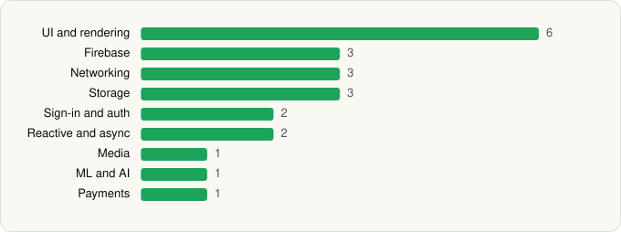

<picture><source media="(prefers-color-scheme: dark)" srcset="../../../../assets/logo/logo-dark.svg"></picture> [Tech Stack](../../../../README.md) / [Google LLC](../../../../companies/google-llc.md) / Google Sheets

# Google Sheets

<picture><source media="(prefers-color-scheme: dark)" srcset="../../../../assets/badges/android-dark.svg"></picture> <picture><source media="(prefers-color-scheme: dark)" srcset="../../../../assets/badges/active-dark.svg"></picture>

[Google Play](https://play.google.com/store/apps/details?id=com.google.android.apps.docs.editors.sheets) · [latest.json](latest.json)

| | |
|---|---|
| Company | [Google LLC](../../../../companies/google-llc.md) |
| Store id | `com.google.android.apps.docs.editors.sheets` |
| Bundle / package id | `com.google.android.apps.docs.editors.sheets` |
| Latest version | 1.26.222.02.90 (analysed 2026-06-19) |
| Versions tracked | 1 |
| SDKs in latest version | 22 |
| Languages | C/C++ (native), Java, Kotlin |
| UI | Coil, Glide, Jetpack Compose, Lottie, Material Components |
| Build | Gradle (inferred) |
| Minimum OS | API 26, targets API 37 |
| Devices / ABIs | Android |
| Capabilities | 5 |
| Declares tracking | No |
| Tracked | Yes |

## SDKs by category

<picture><source media="(prefers-color-scheme: dark)" srcset="../../../../assets/charts/apps/android/google-llc/google-sheets-dark.svg"></picture>

- **UI and rendering** (6): AndroidSVG, Coil, Glide, Jetpack Compose, Lottie, Material Components
- **Firebase** (3): Firebase, Google DataTransport, Google Play services
- **Networking** (3): Cronet, Cronet (Google), OkHttp
- **Storage** (3): DataStore, Okio, Room
- **Sign-in and auth** (2): AppAuth, Google Sign-In / Auth
- **Reactive and async** (2): Kotlin Coroutines, RxJava
- **Media** (1): Media3 (ExoPlayer)
- **ML and AI** (1): TensorFlow
- **Payments** (1): Google Play Billing

Capabilities (5)

Contacts (read), Foreground service, Microphone, Notifications, Storage (write)

## Version history

| Version | Analysed | Store update | SDKs | Change | SDK list is a floor | Binary encrypted | File |
|---|---|---|---|---|---|---|---|
| 1.26.222.02.90 | 2026-06-19 |  | 22 |  | No | No | [1.26.222.02.90.json](1.26.222.02.90.json) |

---

Generated by `scripts/build_readme.py` from the JSON files. Do not edit by hand.
