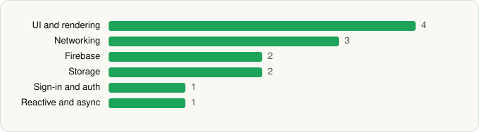

<picture><source media="(prefers-color-scheme: dark)" srcset="../../../../assets/logo/logo-dark.svg"></picture> [Tech Stack](../../../../README.md) / [Google LLC](../../../../companies/google-llc.md) / Google Translate

# Google Translate

<picture><source media="(prefers-color-scheme: dark)" srcset="../../../../assets/badges/android-dark.svg"></picture> <picture><source media="(prefers-color-scheme: dark)" srcset="../../../../assets/badges/active-dark.svg"></picture>

[Google Play](https://play.google.com/store/apps/details?id=com.google.android.apps.translate) · [latest.json](latest.json)

| | |
|---|---|
| Company | [Google LLC](../../../../companies/google-llc.md) |
| Store id | `com.google.android.apps.translate` |
| Bundle / package id | `com.google.android.apps.translate` |
| Latest version | 10.20.41.923213375.5-release (analysed 2026-06-19) |
| Versions tracked | 1 |
| SDKs in latest version | 13 |
| Languages | C/C++ (native), Java, Kotlin |
| UI | Glide, Jetpack Compose, Lottie, Material Components |
| Build | Gradle (inferred) |
| Minimum OS | API 26, targets API 36 |
| Devices / ABIs | Android |
| Capabilities | 7 |
| Declares tracking | No |
| Tracked | Yes |

## SDKs by category

<picture><source media="(prefers-color-scheme: dark)" srcset="../../../../assets/charts/apps/android/google-llc/google-translate-dark.svg"></picture>

- **UI and rendering** (4): Glide, Jetpack Compose, Lottie, Material Components
- **Networking** (3): Cronet, Cronet (Google), Retrofit
- **Firebase** (2): Firebase, Google Play services
- **Storage** (2): DataStore, Room
- **Sign-in and auth** (1): Google Sign-In / Auth
- **Reactive and async** (1): Kotlin Coroutines

Capabilities (7)

Draw over other apps, Foreground service, Foreground service: microphone, Microphone, NFC, Notifications, Storage (write)

## Version history

| Version | Analysed | Store update | SDKs | Change | SDK list is a floor | Binary encrypted | File |
|---|---|---|---|---|---|---|---|
| 10.20.41.923213375.5-release | 2026-06-19 |  | 13 |  | No | No | [10.20.41.923213375.5-release.json](10.20.41.923213375.5-release.json) |

---

Generated by `scripts/build_readme.py` from the JSON files. Do not edit by hand.
