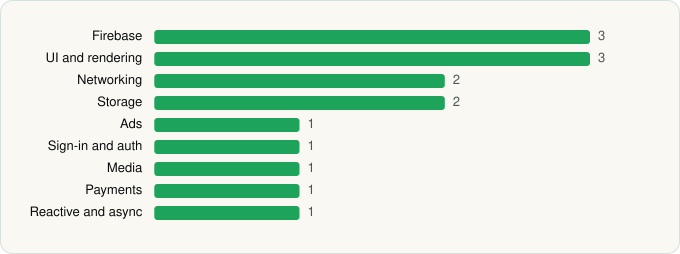

<picture><source media="(prefers-color-scheme: dark)" srcset="../../../../assets/logo/logo-dark.svg"></picture> [Tech Stack](../../../../README.md) / [Google LLC](../../../../companies/google-llc.md) / Google TV Home

# Google TV Home

<picture><source media="(prefers-color-scheme: dark)" srcset="../../../../assets/badges/android-dark.svg"></picture> <picture><source media="(prefers-color-scheme: dark)" srcset="../../../../assets/badges/active-dark.svg"></picture>

[Google Play](https://play.google.com/store/apps/details?id=com.google.android.apps.tv.launcherx) · [latest.json](latest.json)

| | |
|---|---|
| Company | [Google LLC](../../../../companies/google-llc.md) |
| Store id | `com.google.android.apps.tv.launcherx` |
| Bundle / package id | `com.google.android.apps.tv.launcherx` |
| Latest version | 1.0.775915464 (analysed 2026-06-19) |
| Versions tracked | 1 |
| SDKs in latest version | 15 |
| Languages | C/C++ (native), Java, Kotlin |
| UI | Glide, Lottie, Material Components |
| Build | Gradle (inferred) |
| Minimum OS | API 29, targets API 33 |
| Devices / ABIs | Android |
| Capabilities | 6 |
| Declares tracking | Yes |
| Tracked | Yes |

## SDKs by category

<picture><source media="(prefers-color-scheme: dark)" srcset="../../../../assets/charts/apps/android/google-llc/google-tv-home-dark.svg"></picture>

- **Firebase** (3): Firebase, Google DataTransport, Google Play services
- **UI and rendering** (3): Glide, Lottie, Material Components
- **Networking** (2): Cronet, Cronet (Google)
- **Storage** (2): DataStore, Room
- **Ads** (1): Google Mobile Ads (AdMob)
- **Sign-in and auth** (1): Google Sign-In / Auth
- **Media** (1): Media3 (ExoPlayer)
- **Payments** (1): Google Play Billing
- **Reactive and async** (1): Kotlin Coroutines

Capabilities (6)

Advertising ID, Draw over other apps, Foreground service, Microphone, Notifications, Query all installed apps

## Version history

| Version | Analysed | Store update | SDKs | Change | SDK list is a floor | Binary encrypted | File |
|---|---|---|---|---|---|---|---|
| 1.0.775915464 | 2026-06-19 |  | 15 |  | No | No | [1.0.775915464.json](1.0.775915464.json) |

## Model-written summary

> Google TV Home: Kotlin/Java Android TV system app with 94 activities, heavy Google SDKs, native Renderscript, and privileged permissions

Written by a language model from the detected signals (`inferred[]`). It is commentary, not measurement.

---

Generated by `scripts/build_readme.py` from the JSON files. Do not edit by hand.
