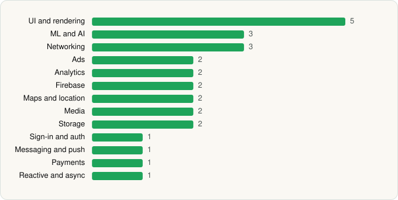

<picture><source media="(prefers-color-scheme: dark)" srcset="../../../../assets/logo/logo-dark.svg"></picture> [Tech Stack](../../../../README.md) / [Google LLC](../../../../companies/google-llc.md) / Google

# Google

<picture><source media="(prefers-color-scheme: dark)" srcset="../../../../assets/badges/android-dark.svg"></picture> <picture><source media="(prefers-color-scheme: dark)" srcset="../../../../assets/badges/active-dark.svg"></picture>

[Google Play](https://play.google.com/store/apps/details?id=com.google.android.googlequicksearchbox) · [latest.json](latest.json)

| | |
|---|---|
| Company | [Google LLC](../../../../companies/google-llc.md) |
| Store id | `com.google.android.googlequicksearchbox` |
| Bundle / package id | `com.google.android.googlequicksearchbox` |
| Latest version | 17.28.32.ve.arm64 (analysed 2026-06-19) |
| Versions tracked | 1 |
| SDKs in latest version | 27 |
| Languages | C/C++ (native), Java, Kotlin |
| UI | Coil, Glide, Jetpack Compose, Lottie, Material Components |
| Build | Gradle (inferred) |
| Minimum OS | API 32, targets API 37 |
| Devices / ABIs | Android |
| Capabilities | 29 |
| Declares tracking | Yes |
| Tracked | Yes |

## SDKs by category

<picture><source media="(prefers-color-scheme: dark)" srcset="../../../../assets/charts/apps/android/google-llc/google-dark.svg"></picture>

- **UI and rendering** (5): Coil, Glide, Jetpack Compose, Lottie, Material Components
- **ML and AI** (3): ML Kit, ML Kit (barcode/vision), Mobile Vision
- **Networking** (3): Cronet, Cronet (Chromium net), Cronet (Google)
- **Ads** (2): Google Ad Manager, Google Mobile Ads (AdMob)
- **Analytics** (2): Firebase Analytics, Google App Measurement
- **Firebase** (2): Firebase, Google Play services
- **Maps and location** (2): Google Location, Google Maps
- **Media** (2): Google Cast, Media3 (ExoPlayer)
- **Storage** (2): DataStore, Room
- **Sign-in and auth** (1): Google Sign-In / Auth
- **Messaging and push** (1): Firebase Messaging
- **Payments** (1): Google Play Billing
- **Reactive and async** (1): Kotlin Coroutines

Capabilities (29)

Advertising ID, Approximate location, Background location, Bluetooth, Bluetooth (connect), Bluetooth (scan), Calendar (read), Calendar (write), Camera, Contacts (read), Contacts (write), Draw over other apps, Fingerprint auth, Foreground service, Foreground service: camera, Foreground service: media playback, Foreground service: microphone, Media: images, Media: video, Microphone, NFC, Notifications, Phone / carrier info, Precise location, Query all installed apps, SMS (read), SMS (send), Storage (read), Storage (write)

## Version history

| Version | Analysed | Store update | SDKs | Change | SDK list is a floor | Binary encrypted | File |
|---|---|---|---|---|---|---|---|
| 17.28.32.ve.arm64 | 2026-06-19 |  | 27 |  | No | No | [17.28.32.ve.arm64.json](17.28.32.ve.arm64.json) |

---

Generated by `scripts/build_readme.py` from the JSON files. Do not edit by hand.
