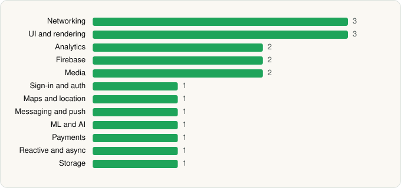

<picture><source media="(prefers-color-scheme: dark)" srcset="../../../../assets/logo/logo-dark.svg"></picture> [Tech Stack](../../../../README.md) / [Google LLC](../../../../companies/google-llc.md) / YouTube Music

# YouTube Music

<picture><source media="(prefers-color-scheme: dark)" srcset="../../../../assets/badges/android-dark.svg"></picture> <picture><source media="(prefers-color-scheme: dark)" srcset="../../../../assets/badges/inactive-dark.svg"></picture>

[Google Play](https://play.google.com/store/apps/details?id=com.google.android.apps.youtube.music) · [latest.json](latest.json)

| | |
|---|---|
| Company | [Google LLC](../../../../companies/google-llc.md) |
| Store id | `com.google.android.apps.youtube.music` |
| Bundle / package id | `com.google.android.apps.youtube.music` |
| Latest version | 9.22.53 (analysed 2026-06-19) |
| Versions tracked | 1 |
| SDKs in latest version | 19 |
| Languages | C/C++ (native), Java, Kotlin |
| UI | Glide, Lottie, Material Components |
| Build | Gradle (inferred) |
| Minimum OS | API 26, targets API 36 |
| Devices / ABIs | Android |
| Capabilities | 14 |
| Declares tracking | Yes |
| Tracked | No. Kept for history. |

## SDKs by category

<picture><source media="(prefers-color-scheme: dark)" srcset="../../../../assets/charts/apps/android/google-llc/youtube-music-dark.svg"></picture>

- **Networking** (3): Cronet, Cronet (Chromium net), Cronet (Google)
- **UI and rendering** (3): Glide, Lottie, Material Components
- **Analytics** (2): Firebase Analytics, Google App Measurement
- **Firebase** (2): Firebase, Google Play services
- **Media** (2): Google Cast, Media3 (ExoPlayer)
- **Sign-in and auth** (1): Google Sign-In / Auth
- **Maps and location** (1): Google Maps
- **Messaging and push** (1): Firebase Messaging
- **ML and AI** (1): ML Kit
- **Payments** (1): Google Play Billing
- **Reactive and async** (1): Kotlin Coroutines
- **Storage** (1): Room

Capabilities (14)

Advertising ID, Bluetooth, Bluetooth (connect), Bluetooth (scan), Camera, Foreground service, Foreground service: media playback, Media: audio, Media: images, NFC, Notifications, Precise location, Storage (read), Storage (write)

## Version history

| Version | Analysed | Store update | SDKs | Change | SDK list is a floor | Binary encrypted | File |
|---|---|---|---|---|---|---|---|
| 9.22.53 | 2026-06-19 |  | 19 |  | No | No | [9.22.53.json](9.22.53.json) |

## Model-written summary

> Android YouTube Music client with Kotlin/Java, heavy native C++ (Cardboard/GVR/VPX/Opus), Cronet, Media3/ExoPlayer, Firebase, and Google services.

Written by a language model from the detected signals (`inferred[]`). It is commentary, not measurement.

---

Generated by `scripts/build_readme.py` from the JSON files. Do not edit by hand.
