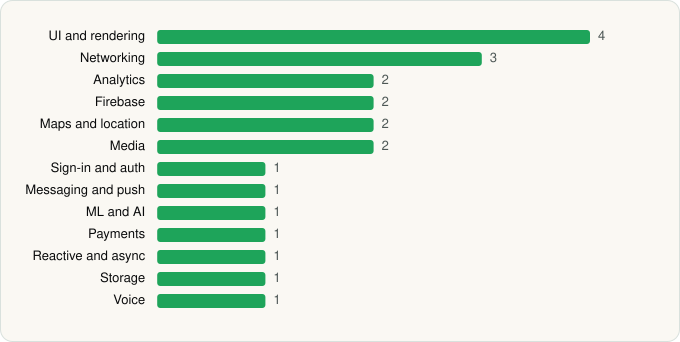

<picture><source media="(prefers-color-scheme: dark)" srcset="../../../../assets/logo/logo-dark.svg"></picture> [Tech Stack](../../../../README.md) / [Google LLC](../../../../companies/google-llc.md) / YouTube

# YouTube

<picture><source media="(prefers-color-scheme: dark)" srcset="../../../../assets/badges/android-dark.svg"></picture> <picture><source media="(prefers-color-scheme: dark)" srcset="../../../../assets/badges/active-dark.svg"></picture>

[Google Play](https://play.google.com/store/apps/details?id=com.google.android.youtube) · [latest.json](latest.json)

| | |
|---|---|
| Company | [Google LLC](../../../../companies/google-llc.md) |
| Store id | `com.google.android.youtube` |
| Bundle / package id | `com.google.android.youtube` |
| Latest version | 21.22.165 (analysed 2026-06-19) |
| Versions tracked | 1 |
| SDKs in latest version | 22 |
| Languages | C/C++ (native), Java, Kotlin |
| UI | Glide, Lottie, Material Components, Rive |
| Build | Gradle (inferred) |
| Minimum OS | API 29, targets API 36 |
| Devices / ABIs | Android |
| Capabilities | 19 |
| Declares tracking | Yes |
| Tracked | Yes |

## SDKs by category

<picture><source media="(prefers-color-scheme: dark)" srcset="../../../../assets/charts/apps/android/google-llc/youtube-dark.svg"></picture>

- **UI and rendering** (4): Glide, Lottie, Material Components, Rive
- **Networking** (3): Cronet, Cronet (Chromium net), Cronet (Google)
- **Analytics** (2): Firebase Analytics, Google App Measurement
- **Firebase** (2): Firebase, Google Play services
- **Maps and location** (2): Google Location, Google Maps
- **Media** (2): Google Cast, Media3 (ExoPlayer)
- **Sign-in and auth** (1): Google Sign-In / Auth
- **Messaging and push** (1): Firebase Messaging
- **ML and AI** (1): ML Kit
- **Payments** (1): Google Play Billing
- **Reactive and async** (1): Kotlin Coroutines
- **Storage** (1): Room
- **Voice** (1): WebRTC

Capabilities (19)

Advertising ID, Approximate location, Biometric auth, Camera, Contacts (read), Draw over other apps, Fingerprint auth, Foreground service, Foreground service: camera, Foreground service: media playback, Foreground service: microphone, Media: images, Media: video, Microphone, NFC, Notifications, Phone / carrier info, Precise location, Storage (write)

## Version history

| Version | Analysed | Store update | SDKs | Change | SDK list is a floor | Binary encrypted | File |
|---|---|---|---|---|---|---|---|
| 21.22.165 | 2026-06-19 |  | 22 |  | No | No | [21.22.165.json](21.22.165.json) |

## Model-written summary

> YouTube Android app using Kotlin/Java with extensive C++ native libraries for media and VR, Cronet for networking, Firebase services, ML Kit, and Rive for UI.

Written by a language model from the detected signals (`inferred[]`). It is commentary, not measurement.

---

Generated by `scripts/build_readme.py` from the JSON files. Do not edit by hand.
