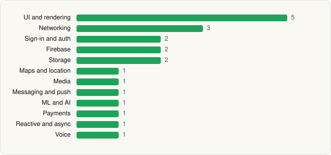

<picture><source media="(prefers-color-scheme: dark)" srcset="../../../../assets/logo/logo-dark.svg"></picture> [Tech Stack](../../../../README.md) / [Google](../../../../companies/google.md) / Gmail

# Gmail

<picture><source media="(prefers-color-scheme: dark)" srcset="../../../../assets/badges/android-dark.svg"></picture> <picture><source media="(prefers-color-scheme: dark)" srcset="../../../../assets/badges/inactive-dark.svg"></picture>

[Google Play](https://play.google.com/store/apps/details?id=com.google.android.gm) · [latest.json](latest.json)

| | |
|---|---|
| Company | [Google](../../../../companies/google.md) |
| Store id | `com.google.android.gm` |
| Bundle / package id | `com.google.android.gm` |
| Latest version | 2026.10.19.1005695425.Release (analysed 2026-11-02) |
| Versions tracked | 2 |
| SDKs in latest version | 21 |
| Languages | C/C++ (native), Java, Kotlin |
| UI | Coil, Glide, Jetpack Compose, Lottie, Material Components |
| Build | Gradle (inferred) |
| Minimum OS | API 24, targets API 37 |
| Devices / ABIs | Android |
| Capabilities | 16 |
| Declares tracking | Yes |
| Tracked | No. Kept for history. |

## SDKs by category

<picture><source media="(prefers-color-scheme: dark)" srcset="../../../../assets/charts/apps/android/google/gmail-dark.svg"></picture>

- **UI and rendering** (5): Coil, Glide, Jetpack Compose, Lottie, Material Components
- **Networking** (3): Cronet, Cronet (Google), OkHttp
- **Sign-in and auth** (2): AppAuth, Google Sign-In / Auth
- **Firebase** (2): Firebase, Google Play services
- **Storage** (2): DataStore, Room
- **Maps and location** (1): Google Maps
- **Media** (1): Media3 (ExoPlayer)
- **Messaging and push** (1): Firebase Messaging
- **ML and AI** (1): ML Kit
- **Payments** (1): Google Play Billing
- **Reactive and async** (1): Kotlin Coroutines
- **Voice** (1): WebRTC

Capabilities (16)

Advertising ID, Bluetooth, Bluetooth (connect), Calendar (read), Calendar (write), Camera, Contacts (read), Contacts (write), Foreground service, Foreground service: camera, Foreground service: media playback, Foreground service: microphone, Microphone, Notifications, Phone / carrier info, Storage (write)

## Version history

| Version | Analysed | Store update | SDKs | Change | SDK list is a floor | Binary encrypted | File |
|---|---|---|---|---|---|---|---|
| 2026.10.19.1005695425.Release | 2026-11-02 |  | 21 | +2 / −0 | No | No | [2026.10.19.1005695425.Release.json](2026.10.19.1005695425.Release.json) |
| 2026.05.19.925511829.Release | 2026-06-19 |  | 19 |  | No | No | [2026.05.19.925511829.Release.json](2026.05.19.925511829.Release.json) |

### SDK changes between versions

- 2026.05.19.925511829.Release → 2026.10.19.1005695425.Release: added DataStore, OkHttp

---

Generated by `scripts/build_readme.py` from the JSON files. Do not edit by hand.
