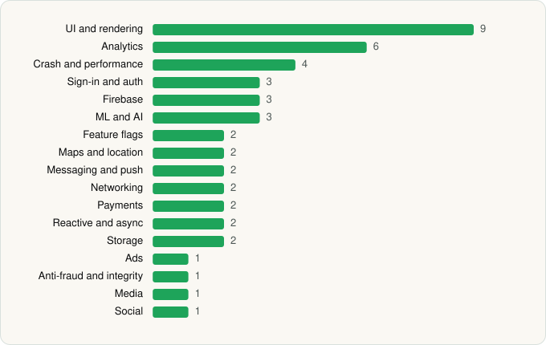

<picture><source media="(prefers-color-scheme: dark)" srcset="../../../../assets/logo/logo-dark.svg"></picture> [Tech Stack](../../../../README.md) / [Gopuff](../../../../companies/gopuff.md) / Gopuff

# Gopuff - Grocery Delivery

<picture><source media="(prefers-color-scheme: dark)" srcset="../../../../assets/badges/android-dark.svg"></picture> <picture><source media="(prefers-color-scheme: dark)" srcset="../../../../assets/badges/active-dark.svg"></picture> <picture><source media="(prefers-color-scheme: dark)" srcset="../../../../assets/badges/floor-dark.svg"></picture>

[Google Play](https://play.google.com/store/apps/details?id=com.main.gopuff) · [latest.json](latest.json)

| | |
|---|---|
| Company | [Gopuff](../../../../companies/gopuff.md) |
| Store id | `com.main.gopuff` |
| Bundle / package id | `com.main.gopuff` |
| Latest version | 12.12.0 (analysed 2026-06-30) |
| Versions tracked | 1 |
| SDKs in latest version | 46 |
| Languages | C/C++ (native), Java, Kotlin, React Native / JavaScript |
| UI | Fresco, Glide, Jetpack Compose, Lottie, Material Components |
| Build | Gradle (inferred), R8 / ProGuard (name obfuscation detected) |
| Minimum OS | API 26, targets API 36 |
| Devices / ABIs | Android |
| Capabilities | 16 |
| Declares tracking | Yes |
| Tracked | Yes |

## SDKs by category

<picture><source media="(prefers-color-scheme: dark)" srcset="../../../../assets/charts/apps/android/gopuff/gopuff-dark.svg"></picture>

- **UI and rendering** (9): AndroidSVG, FlashList, Fresco, Glide, Jetpack Compose, Lottie, Material Components, React Native Reanimated, react-native-svg
- **Analytics** (6): Amplitude, AppsFlyer, Branch, Facebook SDK, Firebase Analytics, Google App Measurement
- **Crash and performance** (4): Datadog, Datadog (native), Firebase Crashlytics, Firebase Performance
- **Sign-in and auth** (3): Credential Manager, Facebook Login, Google Sign-In / Auth
- **Firebase** (3): Firebase, Google DataTransport, Google Play services
- **ML and AI** (3): ML Kit, TensorFlow, TensorFlow Lite
- **Feature flags** (2): Firebase Remote Config, Split
- **Maps and location** (2): Google Location, Google Maps
- **Messaging and push** (2): Braze, Firebase Messaging
- **Networking** (2): axios, OkHttp
- **Payments** (2): Braintree, Stripe
- **Reactive and async** (2): Kotlin Coroutines, RxJava
- **Storage** (2): DataStore, Room
- **Ads** (1): Google Mobile Ads (AdMob)
- **Anti-fraud and integrity** (1): Play Integrity
- **Media** (1): Media3 (ExoPlayer)
- **Social** (1): Facebook Share

Capabilities (16)

Advertising ID, Approximate location, Biometric auth, Bluetooth, Bluetooth (connect), Bluetooth (scan), Camera, Contacts (read), Fingerprint auth, Foreground service, Foreground service: media playback, Microphone, Notifications, Precise location, Storage (read), Storage (write)

## Version history

| Version | Analysed | Store update | SDKs | Change | SDK list is a floor | Binary encrypted | File |
|---|---|---|---|---|---|---|---|
| 12.12.0 | 2026-06-30 |  | 46 |  | Yes | No | [12.12.0.json](12.12.0.json) |

## Model-written summary

> React Native (Hermes) Android grocery app with Jetpack Compose, TensorFlow Lite models, native Datadog, and Braintree/Stripe

Written by a language model from the detected signals (`inferred[]`). It is commentary, not measurement.

---

Generated by `scripts/build_readme.py` from the JSON files. Do not edit by hand.
