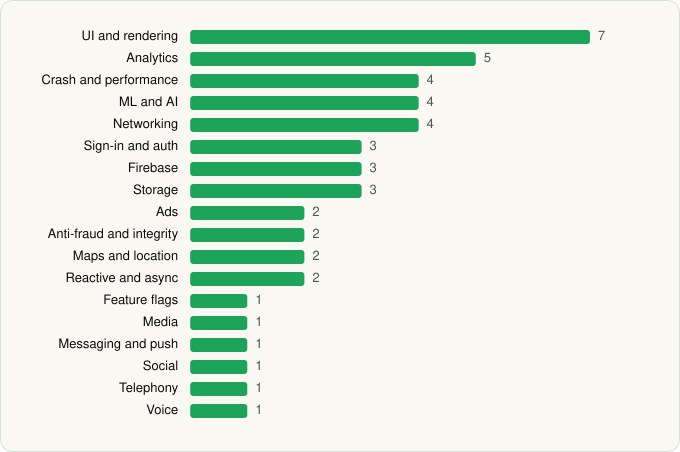

<picture><source media="(prefers-color-scheme: dark)" srcset="../../../../assets/logo/logo-dark.svg"></picture> [Tech Stack](../../../../README.md) / [Grab Holdings](../../../../companies/grab-holdings.md) / Grab

# Grab - Taxi & Food Delivery

<picture><source media="(prefers-color-scheme: dark)" srcset="../../../../assets/badges/android-dark.svg"></picture> <picture><source media="(prefers-color-scheme: dark)" srcset="../../../../assets/badges/inactive-dark.svg"></picture>

[Google Play](https://play.google.com/store/apps/details?id=com.grabtaxi.passenger) · [latest.json](latest.json)

| | |
|---|---|
| Company | [Grab Holdings](../../../../companies/grab-holdings.md) |
| Store id | `com.grabtaxi.passenger` |
| Bundle / package id | `com.grabtaxi.passenger` |
| Latest version | 5.430.0 (analysed 2026-10-24) |
| Versions tracked | 1 |
| SDKs in latest version | 47 |
| Languages | C/C++ (native), Java, Kotlin |
| UI | Coil, Glide, Jetpack Compose, Lottie, Material Components, Picasso |
| Build | Gradle (inferred) |
| Minimum OS | API 24, targets API 36 |
| Devices / ABIs | Android |
| Capabilities | 22 |
| Declares tracking | Yes |
| Tracked | No. Kept for history. |

## SDKs by category

<picture><source media="(prefers-color-scheme: dark)" srcset="../../../../assets/charts/apps/android/grab-holdings/grab-dark.svg"></picture>

- **UI and rendering** (7): Coil, Glide, Jetpack Compose, Lottie, Markwon, Material Components, Picasso
- **Analytics** (5): AppsFlyer, Facebook SDK, Firebase Analytics, Google App Measurement, Leanplum
- **Crash and performance** (4): Datadog, Firebase Crashlytics, Firebase Performance, Sentry
- **ML and AI** (4): ML Kit, Mobile Vision, TensorFlow, TensorFlow Lite
- **Networking** (4): Cronet, Cronet (Google), OkHttp, Retrofit
- **Sign-in and auth** (3): Credential Manager, Facebook Login, Google Sign-In / Auth
- **Firebase** (3): Firebase, Google DataTransport, Google Play services
- **Storage** (3): DataStore, Okio, Room
- **Ads** (2): Google Ad Manager, Google Mobile Ads (AdMob)
- **Anti-fraud and integrity** (2): Play Integrity, reCAPTCHA
- **Maps and location** (2): Google Location, Mapbox
- **Reactive and async** (2): Kotlin Coroutines, RxJava
- **Feature flags** (1): Firebase Remote Config
- **Media** (1): ExoPlayer
- **Messaging and push** (1): Firebase Messaging
- **Social** (1): Facebook Share
- **Telephony** (1): libphonenumber
- **Voice** (1): WebRTC

Capabilities (22)

Advertising ID, Approximate location, Background location, Biometric auth, Bluetooth, Bluetooth (connect), Calendar (read), Calendar (write), Camera, Contacts (read), Draw over other apps, Fingerprint auth, Foreground service, Foreground service: location, Foreground service: microphone, Microphone, NFC, Notifications, Phone / carrier info, Precise location, Storage (read), Storage (write)

## Version history

| Version | Analysed | Store update | SDKs | Change | SDK list is a floor | Binary encrypted | File |
|---|---|---|---|---|---|---|---|
| 5.430.0 | 2026-10-24 | 2026-10-20 | 47 |  | No | No | [5.430.0.json](5.430.0.json) |

---

Generated by `scripts/build_readme.py` from the JSON files. Do not edit by hand.
