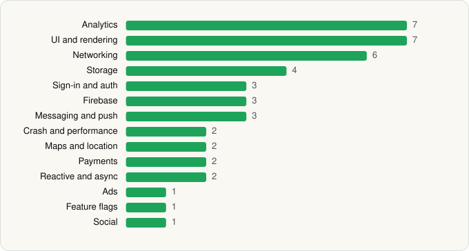

<picture><source media="(prefers-color-scheme: dark)" srcset="../../../../assets/logo/logo-dark.svg"></picture> [Tech Stack](../../../../README.md) / [Grubhub](../../../../companies/grubhub.md) / Grubhub

# Grubhub: Food Delivery

<picture><source media="(prefers-color-scheme: dark)" srcset="../../../../assets/badges/android-dark.svg"></picture> <picture><source media="(prefers-color-scheme: dark)" srcset="../../../../assets/badges/inactive-dark.svg"></picture> <picture><source media="(prefers-color-scheme: dark)" srcset="../../../../assets/badges/floor-dark.svg"></picture>

[Google Play](https://play.google.com/store/apps/details?id=com.grubhub.android) · [latest.json](latest.json)

| | |
|---|---|
| Company | [Grubhub](../../../../companies/grubhub.md) |
| Store id | `com.grubhub.android` |
| Bundle / package id | `com.grubhub.android` |
| Latest version | 2026.43.1 (analysed 2026-11-02) |
| Versions tracked | 2 |
| SDKs in latest version | 44 |
| Languages | C/C++ (native), Java, Kotlin |
| UI | Coil, Glide, Jetpack Compose, Lottie, Material Components, Picasso |
| Build | Gradle (inferred), R8 / ProGuard (name obfuscation detected) |
| Minimum OS | API 29, targets API 36 |
| Devices / ABIs | Android |
| Capabilities | 12 |
| Declares tracking | Yes |
| Tracked | No. Kept for history. |

## SDKs by category

<picture><source media="(prefers-color-scheme: dark)" srcset="../../../../assets/charts/apps/android/grubhub/grubhub-dark.svg"></picture>

- **Analytics** (7): Amplitude, AppsFlyer, Branch, Facebook SDK, Firebase Analytics, Google Analytics (legacy), Google App Measurement
- **UI and rendering** (7): AndroidSVG, Coil, Glide, Jetpack Compose, Lottie, Material Components, Picasso
- **Networking** (6): Cronet, Cronet (Google), Ktor, OkHttp, Retrofit, Volley
- **Storage** (4): DataStore, Okio, Room, SQLDelight
- **Sign-in and auth** (3): AppAuth, Facebook Login, Google Sign-In / Auth
- **Firebase** (3): Firebase, Google DataTransport, Google Play services
- **Messaging and push** (3): Braze, Firebase Messaging, Zendesk
- **Crash and performance** (2): Datadog, Firebase Crashlytics
- **Maps and location** (2): Google Location, Google Maps
- **Payments** (2): Braintree, Stripe
- **Reactive and async** (2): Kotlin Coroutines, RxJava
- **Ads** (1): Google Mobile Ads (AdMob)
- **Feature flags** (1): LaunchDarkly
- **Social** (1): Facebook Share

Capabilities (12)

Advertising ID, Approximate location, Biometric auth, Camera, Fingerprint auth, Foreground service, NFC, Notifications, Phone / carrier info, Precise location, Storage (read), Storage (write)

## Version history

| Version | Analysed | Store update | SDKs | Change | SDK list is a floor | Binary encrypted | File |
|---|---|---|---|---|---|---|---|
| 2026.43.1 | 2026-11-02 |  | 44 | +2 / −2 | Yes | No | [2026.43.1.json](2026.43.1.json) |
| 2026.23 | 2026-06-19 |  | 44 |  | Yes | No | [2026.23.json](2026.23.json) |

### SDK changes between versions

- 2026.23 → 2026.43.1: added Cronet, Cronet (Google); removed axios, Fresco

---

Generated by `scripts/build_readme.py` from the JSON files. Do not edit by hand.
