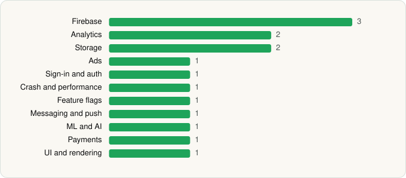

<picture><source media="(prefers-color-scheme: dark)" srcset="../../../../assets/logo/logo-dark.svg"></picture> [Tech Stack](../../../../README.md) / [HANLONG GROUP (HK) LIMITED](../../../../companies/hanlong-group-hk-limited.md) / PDF Reader, Annotate on PDF

# PDF Reader, Annotate on PDF

<picture><source media="(prefers-color-scheme: dark)" srcset="../../../../assets/badges/android-dark.svg"></picture> <picture><source media="(prefers-color-scheme: dark)" srcset="../../../../assets/badges/inactive-dark.svg"></picture>

[Google Play](https://play.google.com/store/apps/details?id=com.ebookpdf.pdfreaderpro.allpdfviewer) · [latest.json](latest.json)

| | |
|---|---|
| Company | [HANLONG GROUP (HK) LIMITED](../../../../companies/hanlong-group-hk-limited.md) |
| Store id | `com.ebookpdf.pdfreaderpro.allpdfviewer` |
| Bundle / package id | `com.ebookpdf.pdfreaderpro.allpdfviewer` |
| Latest version | 3.2.2 (analysed 2026-11-11) |
| Versions tracked | 1 |
| SDKs in latest version | 15 |
| Languages | C/C++ (native), Java |
| UI | Material Components |
| Build | Gradle (inferred) |
| Minimum OS | API 26, targets API 36 |
| Devices / ABIs | Android |
| Capabilities | 9 |
| Declares tracking | Yes |
| Tracked | No. Kept for history. |

## SDKs by category

<picture><source media="(prefers-color-scheme: dark)" srcset="../../../../assets/charts/apps/android/hanlong-group-hk-limited/pdf-reader-annotate-on-pdf-dark.svg"></picture>

- **Firebase** (3): Firebase, Google DataTransport, Google Play services
- **Analytics** (2): Firebase Analytics, Google App Measurement
- **Storage** (2): DataStore, Room
- **Ads** (1): Google Mobile Ads (AdMob)
- **Sign-in and auth** (1): Google Sign-In / Auth
- **Crash and performance** (1): Firebase Crashlytics
- **Feature flags** (1): Firebase Remote Config
- **Messaging and push** (1): Firebase Messaging
- **ML and AI** (1): ML Kit
- **Payments** (1): Google Play Billing
- **UI and rendering** (1): Material Components

Capabilities (9)

Advertising ID, All-files storage access, Biometric auth, Camera, Fingerprint auth, Foreground service, Notifications, Storage (read), Storage (write)

## Version history

| Version | Analysed | Store update | SDKs | Change | SDK list is a floor | Binary encrypted | File |
|---|---|---|---|---|---|---|---|
| 3.2.2 | 2026-11-11 |  | 15 |  | No | No | [3.2.2.json](3.2.2.json) |

---

Generated by `scripts/build_readme.py` from the JSON files. Do not edit by hand.
