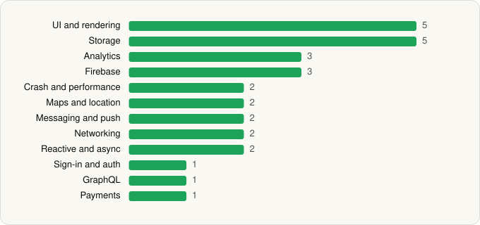

<picture><source media="(prefers-color-scheme: dark)" srcset="../../../../assets/logo/logo-dark.svg"></picture> [Tech Stack](../../../../README.md) / [Hilton](../../../../companies/hilton.md) / Hilton Honors

# Hilton Honors: Book Hotels

<picture><source media="(prefers-color-scheme: dark)" srcset="../../../../assets/badges/android-dark.svg"></picture> <picture><source media="(prefers-color-scheme: dark)" srcset="../../../../assets/badges/inactive-dark.svg"></picture> <picture><source media="(prefers-color-scheme: dark)" srcset="../../../../assets/badges/floor-dark.svg"></picture>

[Google Play](https://play.google.com/store/apps/details?id=com.hilton.android.hhonors) · [latest.json](latest.json)

| | |
|---|---|
| Company | [Hilton](../../../../companies/hilton.md) |
| Store id | `com.hilton.android.hhonors` |
| Bundle / package id | `com.hilton.android.hhonors` |
| Latest version | 2026.10.20 (analysed 2026-11-02) |
| Versions tracked | 2 |
| SDKs in latest version | 29 |
| Languages | C/C++ (native), Java, Kotlin |
| UI | Coil, Glide, Jetpack Compose, Material Components |
| Build | Gradle (inferred), R8 / ProGuard (name obfuscation detected) |
| Minimum OS | API 30, targets API 36 |
| Devices / ABIs | Android |
| Capabilities | 12 |
| Declares tracking | Yes |
| Tracked | No. Kept for history. |

## SDKs by category

<picture><source media="(prefers-color-scheme: dark)" srcset="../../../../assets/charts/apps/android/hilton/hilton-honors-dark.svg"></picture>

- **UI and rendering** (5): Coil, Glide, Jetpack Compose, Markwon, Material Components
- **Storage** (5): Okio, Realm, Room, SQLCipher, SQLDelight
- **Analytics** (3): Adobe Experience Platform, Branch, Qualtrics
- **Firebase** (3): Firebase, Google DataTransport, Google Play services
- **Crash and performance** (2): Embrace, OpenTelemetry
- **Maps and location** (2): Google Location, Google Maps
- **Messaging and push** (2): Braze, Firebase Messaging
- **Networking** (2): OkHttp, Retrofit
- **Reactive and async** (2): Kotlin Coroutines, RxJava
- **Sign-in and auth** (1): Google Sign-In / Auth
- **GraphQL** (1): Apollo GraphQL
- **Payments** (1): Adyen

Capabilities (12)

Approximate location, Bluetooth, Bluetooth (connect), Bluetooth (scan), Contacts (read), Fingerprint auth, Foreground service, Notifications, Phone / carrier info, Precise location, Storage (read), Storage (write)

## Version history

| Version | Analysed | Store update | SDKs | Change | SDK list is a floor | Binary encrypted | File |
|---|---|---|---|---|---|---|---|
| 2026.10.20 | 2026-11-02 | 2026-11-02 | 29 | +0 / −0 | Yes | No | [2026.10.20.json](2026.10.20.json) |
| 2026.6.9 | 2026-06-28 |  | 29 |  | Yes | No | [2026.6.9.json](2026.6.9.json) |

---

Generated by `scripts/build_readme.py` from the JSON files. Do not edit by hand.
