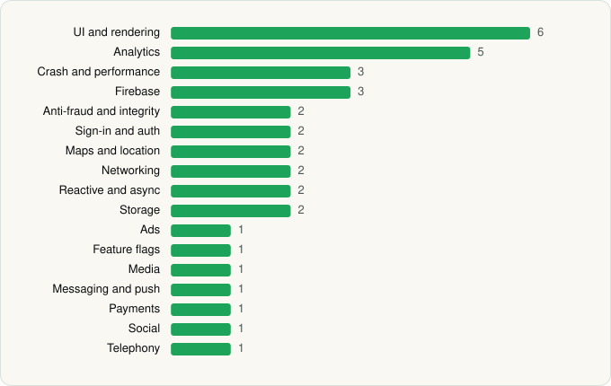

<picture><source media="(prefers-color-scheme: dark)" srcset="../../../../assets/logo/logo-dark.svg"></picture> [Tech Stack](../../../../README.md) / [Hopper Inc.](../../../../companies/hopper-inc.md) / Hopper

# Hopper: Hotels, Flights & Cars

<picture><source media="(prefers-color-scheme: dark)" srcset="../../../../assets/badges/android-dark.svg"></picture> <picture><source media="(prefers-color-scheme: dark)" srcset="../../../../assets/badges/inactive-dark.svg"></picture>

[Google Play](https://play.google.com/store/apps/details?id=com.hopper.mountainview.play) · [latest.json](latest.json)

| | |
|---|---|
| Company | [Hopper Inc.](../../../../companies/hopper-inc.md) |
| Store id | `com.hopper.mountainview.play` |
| Bundle / package id | `com.hopper.mountainview.play` |
| Latest version | 5.107.0 (analysed 2026-06-25) |
| Versions tracked | 1 |
| SDKs in latest version | 36 |
| Languages | C/C++ (native), Java, Kotlin |
| UI | Coil, Glide, Jetpack Compose, Lottie, Material Components |
| Build | Gradle (inferred) |
| Minimum OS | API 29, targets API 35 |
| Devices / ABIs | Android |
| Capabilities | 6 |
| Declares tracking | Yes |
| Tracked | No. Kept for history. |

## SDKs by category

<picture><source media="(prefers-color-scheme: dark)" srcset="../../../../assets/charts/apps/android/hopper-inc/hopper-dark.svg"></picture>

- **UI and rendering** (6): Coil, Glide, Jetpack Compose, Lottie, Markwon, Material Components
- **Analytics** (5): AppsFlyer, Facebook SDK, Firebase Analytics, Google App Measurement, Mixpanel
- **Crash and performance** (3): Datadog, Firebase Crashlytics, Firebase Performance
- **Firebase** (3): Firebase, Google DataTransport, Google Play services
- **Anti-fraud and integrity** (2): Play Integrity, reCAPTCHA
- **Sign-in and auth** (2): Facebook Login, Google Sign-In / Auth
- **Maps and location** (2): Google Location, Google Maps
- **Networking** (2): OkHttp, Retrofit
- **Reactive and async** (2): Kotlin Coroutines, RxJava
- **Storage** (2): Okio, Room
- **Ads** (1): Google Mobile Ads (AdMob)
- **Feature flags** (1): Firebase Remote Config
- **Media** (1): Media3 (ExoPlayer)
- **Messaging and push** (1): Firebase Messaging
- **Payments** (1): Adyen
- **Social** (1): Facebook Share
- **Telephony** (1): libphonenumber

Capabilities (6)

Advertising ID, Approximate location, Foreground service, Notifications, Phone / carrier info, Storage (read)

## Version history

| Version | Analysed | Store update | SDKs | Change | SDK list is a floor | Binary encrypted | File |
|---|---|---|---|---|---|---|---|
| 5.107.0 | 2026-06-25 |  | 36 |  | No | No | [5.107.0.json](5.107.0.json) |

---

Generated by `scripts/build_readme.py` from the JSON files. Do not edit by hand.
