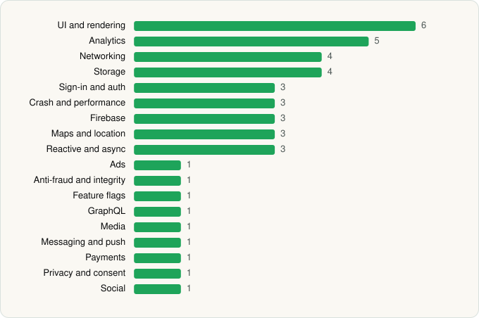

<picture><source media="(prefers-color-scheme: dark)" srcset="../../../../assets/logo/logo-dark.svg"></picture> [Tech Stack](../../../../README.md) / [Hotels.com LP](../../../../companies/hotels-com-lp.md) / Hotels.com

# Hotels.com: Travel Booking

<picture><source media="(prefers-color-scheme: dark)" srcset="../../../../assets/badges/android-dark.svg"></picture> <picture><source media="(prefers-color-scheme: dark)" srcset="../../../../assets/badges/active-dark.svg"></picture>

[Google Play](https://play.google.com/store/apps/details?id=com.hcom.android) · [latest.json](latest.json)

| | |
|---|---|
| Company | [Hotels.com LP](../../../../companies/hotels-com-lp.md) |
| Store id | `com.hcom.android` |
| Bundle / package id | `com.hcom.android` |
| Latest version | 2026.43.0 (analysed 2026-11-02) |
| Versions tracked | 2 |
| SDKs in latest version | 43 |
| Languages | C/C++ (native), Java, Kotlin |
| UI | Coil, Glide, Jetpack Compose, Lottie, Material Components |
| Build | Gradle (inferred) |
| Minimum OS | API 29, targets API 36 |
| Devices / ABIs | Android |
| Capabilities | 13 |
| Declares tracking | Yes |
| Tracked | Yes |

## SDKs by category

<picture><source media="(prefers-color-scheme: dark)" srcset="../../../../assets/charts/apps/android/hotels-com-lp/hotels-com-dark.svg"></picture>

- **UI and rendering** (6): AndroidSVG, Coil, Glide, Jetpack Compose, Lottie, Material Components
- **Analytics** (5): AppsFlyer, Facebook SDK, Firebase Analytics, Google App Measurement, Qualtrics
- **Networking** (4): Ktor, OkHttp, Retrofit, Volley
- **Storage** (4): DataStore, Okio, Room, SQLDelight
- **Sign-in and auth** (3): Credential Manager, Facebook Login, Google Sign-In / Auth
- **Crash and performance** (3): Datadog, Firebase Crashlytics, Firebase Performance
- **Firebase** (3): Firebase, Google DataTransport, Google Play services
- **Maps and location** (3): Google Location, Google Maps, Mapbox
- **Reactive and async** (3): Kotlin Coroutines, RxJava, RxJava 3
- **Ads** (1): Google Mobile Ads (AdMob)
- **Anti-fraud and integrity** (1): Play Integrity
- **Feature flags** (1): Firebase Remote Config
- **GraphQL** (1): Apollo GraphQL
- **Media** (1): Media3 (ExoPlayer)
- **Messaging and push** (1): Firebase Messaging
- **Payments** (1): Braintree
- **Privacy and consent** (1): OneTrust
- **Social** (1): Facebook Share

Capabilities (13)

Advertising ID, Approximate location, Biometric auth, Calendar (read), Calendar (write), Camera, Fingerprint auth, Foreground service, Notifications, Phone / carrier info, Precise location, Storage (read), Storage (write)

## Version history

| Version | Analysed | Store update | SDKs | Change | SDK list is a floor | Binary encrypted | File |
|---|---|---|---|---|---|---|---|
| 2026.43.0 | 2026-11-02 | 2026-10-30 | 43 | +1 / −0 | No | No | [2026.43.0.json](2026.43.0.json) |
| 2026.25.0 | 2026-06-25 |  | 42 |  | No | No | [2026.25.0.json](2026.25.0.json) |

### SDK changes between versions

- 2026.25.0 → 2026.43.0: added Mapbox

---

Generated by `scripts/build_readme.py` from the JSON files. Do not edit by hand.
