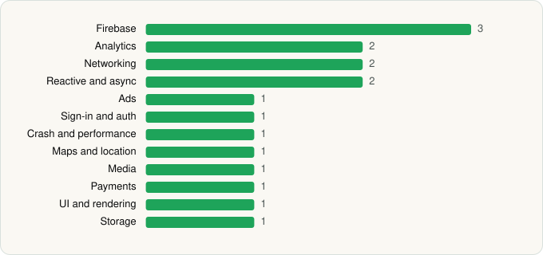

<picture><source media="(prefers-color-scheme: dark)" srcset="../../../../assets/logo/logo-dark.svg"></picture> [Tech Stack](../../../../README.md) / [iHeartMedia, Inc.](../../../../companies/iheartmedia-inc.md) / iHeartRadio for Google TV

# iHeartRadio for Google TV

<picture><source media="(prefers-color-scheme: dark)" srcset="../../../../assets/badges/android-dark.svg"></picture> <picture><source media="(prefers-color-scheme: dark)" srcset="../../../../assets/badges/inactive-dark.svg"></picture>

[Google Play](https://play.google.com/store/apps/details?id=com.clearchannel.iheartradio.tv) · [latest.json](latest.json)

| | |
|---|---|
| Company | [iHeartMedia, Inc.](../../../../companies/iheartmedia-inc.md) |
| Store id | `com.clearchannel.iheartradio.tv` |
| Bundle / package id | `com.clearchannel.iheartradio.tv` |
| Latest version | 4.12.0 (analysed 2026-06-19) |
| Versions tracked | 1 |
| SDKs in latest version | 17 |
| Languages | Java, Kotlin |
| UI | Glide |
| Build | Gradle (inferred) |
| Minimum OS | API 22, targets API 34 |
| Devices / ABIs | Android |
| Capabilities | 3 |
| Declares tracking | Yes |
| Tracked | No. Kept for history. |

## SDKs by category

<picture><source media="(prefers-color-scheme: dark)" srcset="../../../../assets/charts/apps/android/iheartmedia-inc/iheartradio-for-google-tv-dark.svg"></picture>

- **Firebase** (3): Firebase, Google DataTransport, Google Play services
- **Analytics** (2): Firebase Analytics, Google App Measurement
- **Networking** (2): OkHttp, Retrofit
- **Reactive and async** (2): Kotlin Coroutines, RxJava
- **Ads** (1): Google Mobile Ads (AdMob)
- **Sign-in and auth** (1): Google Sign-In / Auth
- **Crash and performance** (1): Firebase Crashlytics
- **Maps and location** (1): Google Location
- **Media** (1): ExoPlayer
- **Payments** (1): Google Play Billing
- **UI and rendering** (1): Glide
- **Storage** (1): Okio

Capabilities (3)

Advertising ID, Foreground service, Foreground service: media playback

## Version history

| Version | Analysed | Store update | SDKs | Change | SDK list is a floor | Binary encrypted | File |
|---|---|---|---|---|---|---|---|
| 4.12.0 | 2026-06-19 |  | 17 |  | No | No | [4.12.0.json](4.12.0.json) |

## Model-written summary

> Android TV app in Kotlin/Java using ExoPlayer for media, Retrofit networking to Firebase, Google SDKs for ads/billing, with 10 services

Written by a language model from the detected signals (`inferred[]`). It is commentary, not measurement.

---

Generated by `scripts/build_readme.py` from the JSON files. Do not edit by hand.
