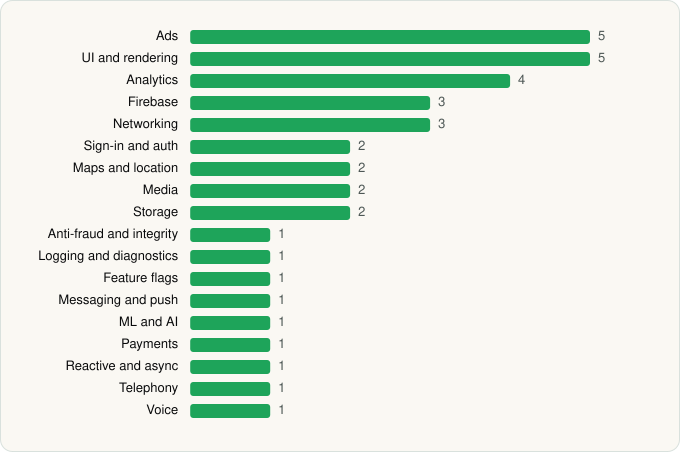

<picture><source media="(prefers-color-scheme: dark)" srcset="../../../../assets/logo/logo-dark.svg"></picture> [Tech Stack](../../../../README.md) / [imo.im](../../../../companies/imo-im.md) / imo-International Calls & Chat

# imo-International Calls & Chat

<picture><source media="(prefers-color-scheme: dark)" srcset="../../../../assets/badges/android-dark.svg"></picture> <picture><source media="(prefers-color-scheme: dark)" srcset="../../../../assets/badges/inactive-dark.svg"></picture>

[Google Play](https://play.google.com/store/apps/details?id=com.imo.android.imoim) · [latest.json](latest.json)

| | |
|---|---|
| Company | [imo.im](../../../../companies/imo-im.md) |
| Store id | `com.imo.android.imoim` |
| Bundle / package id | `com.imo.android.imoim` |
| Latest version | 2026.10.1041 (analysed 2026-11-20) |
| Versions tracked | 1 |
| SDKs in latest version | 37 |
| Languages | C/C++ (native), Java, Kotlin |
| UI | Coil, Fresco, Jetpack Compose, Lottie, Material Components |
| Build | Gradle (inferred) |
| Minimum OS | API 21, targets API 36 |
| Devices / ABIs | Android |
| Capabilities | 28 |
| Declares tracking | Yes |
| Tracked | No. Kept for history. |

## SDKs by category

<picture><source media="(prefers-color-scheme: dark)" srcset="../../../../assets/charts/apps/android/imo-im/imo-international-calls-chat-dark.svg"></picture>

- **Ads** (5): AppLovin, Fyber, Google Mobile Ads (AdMob), Pangle, Vungle
- **UI and rendering** (5): Coil, Fresco, Jetpack Compose, Lottie, Material Components
- **Analytics** (4): AppsFlyer, Facebook SDK, Firebase Analytics, Google App Measurement
- **Firebase** (3): Firebase, Google DataTransport, Google Play services
- **Networking** (3): Ktor, OkHttp, Volley
- **Sign-in and auth** (2): Credential Manager, Google Sign-In / Auth
- **Maps and location** (2): Google Location, Google Maps
- **Media** (2): ExoPlayer, Media3 (ExoPlayer)
- **Storage** (2): Room, SQLCipher
- **Anti-fraud and integrity** (1): Play Integrity
- **Logging and diagnostics** (1): LeakCanary
- **Feature flags** (1): Firebase Remote Config
- **Messaging and push** (1): Firebase Messaging
- **ML and AI** (1): ML Kit
- **Payments** (1): Google Play Billing
- **Reactive and async** (1): Kotlin Coroutines
- **Telephony** (1): libphonenumber
- **Voice** (1): WebRTC

Capabilities (28)

Advertising ID, Approximate location, Background location, Biometric auth, Bluetooth, Bluetooth (connect), Bluetooth (scan), Camera, Contacts (read), Contacts (write), Draw over other apps, Fingerprint auth, Foreground service, Foreground service: camera, Foreground service: location, Foreground service: media playback, Foreground service: microphone, Install other apps, Media: audio, Media: images, Media: video, Microphone, NFC, Notifications, Phone / carrier info, Precise location, Storage (read), Storage (write)

## Version history

| Version | Analysed | Store update | SDKs | Change | SDK list is a floor | Binary encrypted | File |
|---|---|---|---|---|---|---|---|
| 2026.10.1041 | 2026-11-20 |  | 37 |  | No | No | [2026.10.1041.json](2026.10.1041.json) |

---

Generated by `scripts/build_readme.py` from the JSON files. Do not edit by hand.
