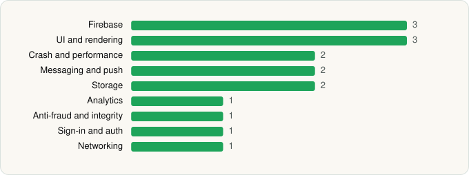

<picture><source media="(prefers-color-scheme: dark)" srcset="../../../../assets/logo/logo-dark.svg"></picture> [Tech Stack](../../../../README.md) / [Indeed, Inc.](../../../../companies/indeed-inc.md) / Glassdoor

# Glassdoor \| Jobs & Careers

<picture><source media="(prefers-color-scheme: dark)" srcset="../../../../assets/badges/android-dark.svg"></picture> <picture><source media="(prefers-color-scheme: dark)" srcset="../../../../assets/badges/inactive-dark.svg"></picture> <picture><source media="(prefers-color-scheme: dark)" srcset="../../../../assets/badges/floor-dark.svg"></picture>

[Google Play](https://play.google.com/store/apps/details?id=com.glassdoor.app) · [latest.json](latest.json)

| | |
|---|---|
| Company | [Indeed, Inc.](../../../../companies/indeed-inc.md) |
| Store id | `com.glassdoor.app` |
| Bundle / package id | `com.glassdoor.app` |
| Latest version | 13.16.0 (analysed 2026-11-26) |
| Versions tracked | 1 |
| SDKs in latest version | 16 |
| Languages | C/C++ (native), Java, Kotlin |
| UI | Glide, Jetpack Compose, Material Components |
| Build | Gradle (inferred), Packer/hardening: Google Play (pairip) anti-tamper |
| Minimum OS | API 29, targets API 36 |
| Devices / ABIs | Android |
| Capabilities | 6 |
| Declares tracking | Yes |
| Tracked | No. Kept for history. |

## SDKs by category

<picture><source media="(prefers-color-scheme: dark)" srcset="../../../../assets/charts/apps/android/indeed-inc/glassdoor-jobs-careers-dark.svg"></picture>

- **Firebase** (3): Firebase, Google DataTransport, Google Play services
- **UI and rendering** (3): Glide, Jetpack Compose, Material Components
- **Crash and performance** (2): Datadog, Firebase Crashlytics
- **Messaging and push** (2): Firebase Messaging, Iterable
- **Storage** (2): DataStore, Room
- **Analytics** (1): AppsFlyer
- **Anti-fraud and integrity** (1): Play Integrity
- **Sign-in and auth** (1): Google Sign-In / Auth
- **Networking** (1): OkHttp

Capabilities (6)

Advertising ID, Approximate location, Foreground service, Microphone, Notifications, Phone / carrier info

## Version history

| Version | Analysed | Store update | SDKs | Change | SDK list is a floor | Binary encrypted | File |
|---|---|---|---|---|---|---|---|
| 13.16.0 | 2026-11-26 |  | 16 |  | Yes | No | [13.16.0.json](13.16.0.json) |

---

Generated by `scripts/build_readme.py` from the JSON files. Do not edit by hand.
