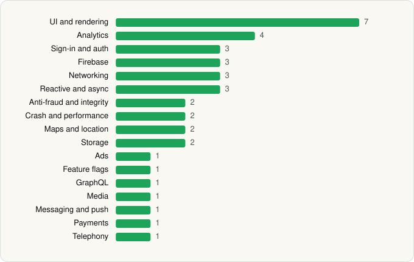

<picture><source media="(prefers-color-scheme: dark)" srcset="../../../../assets/logo/logo-dark.svg"></picture> [Tech Stack](../../../../README.md) / [InPost UK Ltd](../../../../companies/inpost-uk-ltd.md) / InPost

# InPost

<picture><source media="(prefers-color-scheme: dark)" srcset="../../../../assets/badges/android-dark.svg"></picture> <picture><source media="(prefers-color-scheme: dark)" srcset="../../../../assets/badges/inactive-dark.svg"></picture> <picture><source media="(prefers-color-scheme: dark)" srcset="../../../../assets/badges/floor-dark.svg"></picture>

[Google Play](https://play.google.com/store/apps/details?id=uk.co.inpost.inmobile) · [latest.json](latest.json)

| | |
|---|---|
| Company | [InPost UK Ltd](../../../../companies/inpost-uk-ltd.md) |
| Store id | `uk.co.inpost.inmobile` |
| Bundle / package id | `uk.co.inpost.inmobile` |
| Latest version | 2.20.1 (analysed 2026-11-14) |
| Versions tracked | 1 |
| SDKs in latest version | 38 |
| Languages | C/C++ (native), Java, Kotlin |
| UI | Coil, Glide, Jetpack Compose, Lottie, Material Components, Picasso |
| Build | Gradle (inferred), R8 / ProGuard (name obfuscation detected) |
| Minimum OS | API 29, targets API 36 |
| Devices / ABIs | Android |
| Capabilities | 9 |
| Declares tracking | Yes |
| Tracked | No. Kept for history. |

## SDKs by category

<picture><source media="(prefers-color-scheme: dark)" srcset="../../../../assets/charts/apps/android/inpost-uk-ltd/inpost-dark.svg"></picture>

- **UI and rendering** (7): AndroidSVG, Coil, Glide, Jetpack Compose, Lottie, Material Components, Picasso
- **Analytics** (4): Adjust, Firebase Analytics, Google Analytics (legacy), Google App Measurement
- **Sign-in and auth** (3): Credential Manager, Firebase Auth, Google Sign-In / Auth
- **Firebase** (3): Firebase, Google DataTransport, Google Play services
- **Networking** (3): Ktor, OkHttp, Retrofit
- **Reactive and async** (3): Kotlin Coroutines, RxJava, RxJava 3
- **Anti-fraud and integrity** (2): Play Integrity, reCAPTCHA
- **Crash and performance** (2): Firebase Crashlytics, Firebase Performance
- **Maps and location** (2): Google Location, Google Maps
- **Storage** (2): DataStore, Room
- **Ads** (1): Google Mobile Ads (AdMob)
- **Feature flags** (1): Firebase Remote Config
- **GraphQL** (1): Apollo GraphQL
- **Media** (1): Media3 (ExoPlayer)
- **Messaging and push** (1): Firebase Messaging
- **Payments** (1): Stripe
- **Telephony** (1): libphonenumber

Capabilities (9)

Advertising ID, Approximate location, Background location, Camera, Contacts (read), Foreground service, Notifications, Precise location, Storage (write)

## Version history

| Version | Analysed | Store update | SDKs | Change | SDK list is a floor | Binary encrypted | File |
|---|---|---|---|---|---|---|---|
| 2.20.1 | 2026-11-14 |  | 38 |  | Yes | No | [2.20.1.json](2.20.1.json) |

---

Generated by `scripts/build_readme.py` from the JSON files. Do not edit by hand.
