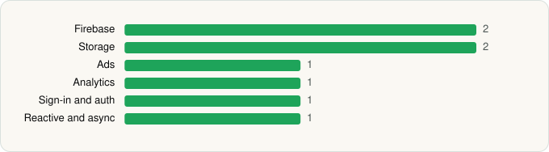

<picture><source media="(prefers-color-scheme: dark)" srcset="../../../../assets/logo/logo-dark.svg"></picture> [Tech Stack](../../../../README.md) / [Insanity Group](../../../../companies/insanity-group.md) / Skins Projeto Grau 2

# Skins Projeto Grau 2

<picture><source media="(prefers-color-scheme: dark)" srcset="../../../../assets/badges/android-dark.svg"></picture> <picture><source media="(prefers-color-scheme: dark)" srcset="../../../../assets/badges/inactive-dark.svg"></picture>

[Google Play](https://play.google.com/store/apps/details?id=com.InsanityGroup.SkinsProjetoGrau2) · [latest.json](latest.json)

| | |
|---|---|
| Company | [Insanity Group](../../../../companies/insanity-group.md) |
| Store id | `com.InsanityGroup.SkinsProjetoGrau2` |
| Bundle / package id | `com.InsanityGroup.SkinsProjetoGrau2` |
| Latest version | 1.0.2 (analysed 2026-11-18) |
| Versions tracked | 1 |
| SDKs in latest version | 8 |
| Languages | C/C++ (native), Java, Kotlin, Unity (C# / IL2CPP) |
| UI | Android Views (inferred) |
| Build | Gradle (inferred) |
| Minimum OS | API 32, targets API 36 |
| Devices / ABIs | Android |
| Capabilities | 2 |
| Declares tracking | Yes |
| Tracked | No. Kept for history. |

## SDKs by category

<picture><source media="(prefers-color-scheme: dark)" srcset="../../../../assets/charts/apps/android/insanity-group/skins-projeto-grau-2-dark.svg"></picture>

- **Firebase** (2): Firebase, Google Play services
- **Storage** (2): DataStore, Room
- **Ads** (1): Google Mobile Ads (AdMob)
- **Analytics** (1): Google App Measurement
- **Sign-in and auth** (1): Google Sign-In / Auth
- **Reactive and async** (1): Kotlin Coroutines

Capabilities (2)

Advertising ID, Foreground service

## Version history

| Version | Analysed | Store update | SDKs | Change | SDK list is a floor | Binary encrypted | File |
|---|---|---|---|---|---|---|---|
| 1.0.2 | 2026-11-18 |  | 8 |  | No | No | [1.0.2.json](1.0.2.json) |

---

Generated by `scripts/build_readme.py` from the JSON files. Do not edit by hand.
