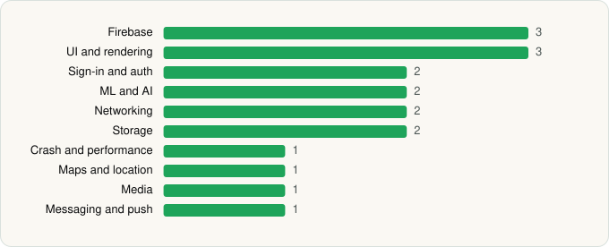

<picture><source media="(prefers-color-scheme: dark)" srcset="../../../../assets/logo/logo-dark.svg"></picture> [Tech Stack](../../../../README.md) / [Inter IKEA Systems B.V](../../../../companies/inter-ikea-systems-b-v.md) / IKEA Home smart

# IKEA Home smart

<picture><source media="(prefers-color-scheme: dark)" srcset="../../../../assets/badges/android-dark.svg"></picture> <picture><source media="(prefers-color-scheme: dark)" srcset="../../../../assets/badges/inactive-dark.svg"></picture>

[Google Play](https://play.google.com/store/apps/details?id=com.ikea.inter.homesmart.system2) · [latest.json](latest.json)

| | |
|---|---|
| Company | [Inter IKEA Systems B.V](../../../../companies/inter-ikea-systems-b-v.md) |
| Store id | `com.ikea.inter.homesmart.system2` |
| Bundle / package id | `com.ikea.inter.homesmart.system2` |
| Latest version | 1.67.0 (analysed 2026-06-19) |
| Versions tracked | 1 |
| SDKs in latest version | 18 |
| Languages | C/C++ (native), Java, Kotlin |
| UI | Glide, Jetpack Compose, Material Components |
| Build | Gradle (inferred) |
| Minimum OS | API 29, targets API 36 |
| Devices / ABIs | Android |
| Capabilities | 10 |
| Declares tracking | Yes |
| Tracked | No. Kept for history. |

## SDKs by category

<picture><source media="(prefers-color-scheme: dark)" srcset="../../../../assets/charts/apps/android/inter-ikea-systems-b-v/ikea-home-smart-dark.svg"></picture>

- **Firebase** (3): Firebase, Google DataTransport, Google Play services
- **UI and rendering** (3): Glide, Jetpack Compose, Material Components
- **Sign-in and auth** (2): Credential Manager, Google Sign-In / Auth
- **ML and AI** (2): ML Kit, ML Kit (barcode/vision)
- **Networking** (2): OkHttp, Retrofit
- **Storage** (2): DataStore, Room
- **Crash and performance** (1): Firebase Crashlytics
- **Maps and location** (1): Google Location
- **Media** (1): Media3 (ExoPlayer)
- **Messaging and push** (1): Firebase Messaging

Capabilities (10)

Approximate location, Biometric auth, Bluetooth, Bluetooth (connect), Bluetooth (scan), Camera, Fingerprint auth, Foreground service, Notifications, Precise location

## Version history

| Version | Analysed | Store update | SDKs | Change | SDK list is a floor | Binary encrypted | File |
|---|---|---|---|---|---|---|---|
| 1.67.0 | 2026-06-19 |  | 18 |  | No | No | [1.67.0.json](1.67.0.json) |

## Model-written summary

> Android Kotlin app for IKEA smart home with Jetpack Compose, native libCHIPController for Matter, ML Kit barcode models, Firebase, and first-party cloud backends

Written by a language model from the detected signals (`inferred[]`). It is commentary, not measurement.

---

Generated by `scripts/build_readme.py` from the JSON files. Do not edit by hand.
