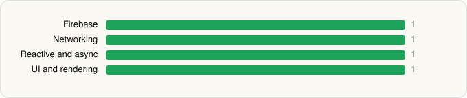

<picture><source media="(prefers-color-scheme: dark)" srcset="../../../../assets/logo/logo-dark.svg"></picture> [Tech Stack](../../../../README.md) / [JPMorgan Chase](../../../../companies/jpmorgan-chase.md) / Chase Mobile Checkout

# Chase Mobile Checkout

<picture><source media="(prefers-color-scheme: dark)" srcset="../../../../assets/badges/android-dark.svg"></picture> <picture><source media="(prefers-color-scheme: dark)" srcset="../../../../assets/badges/inactive-dark.svg"></picture> <picture><source media="(prefers-color-scheme: dark)" srcset="../../../../assets/badges/floor-dark.svg"></picture>

[Google Play](https://play.google.com/store/apps/details?id=com.cp.mpos) · [latest.json](latest.json)

| | |
|---|---|
| Company | [JPMorgan Chase](../../../../companies/jpmorgan-chase.md) |
| Store id | `com.cp.mpos` |
| Bundle / package id | `com.cp.mpos` |
| Latest version | 4.3.1 (analysed 2026-06-19) |
| Versions tracked | 1 |
| SDKs in latest version | 4 |
| Languages | C/C++ (native), Java, Kotlin |
| UI | Material Components |
| Build | Gradle (inferred), R8 / ProGuard (name obfuscation detected) |
| Minimum OS | API 23, targets API 33 |
| Devices / ABIs | Android |
| Capabilities | 10 |
| Declares tracking | No |
| Tracked | No. Kept for history. |

## SDKs by category

<picture><source media="(prefers-color-scheme: dark)" srcset="../../../../assets/charts/apps/android/jpmorgan-chase/chase-mobile-checkout-dark.svg"></picture>

- **Firebase** (1): Google Play services
- **Networking** (1): OkHttp
- **Reactive and async** (1): Kotlin Coroutines
- **UI and rendering** (1): Material Components

Capabilities (10)

Approximate location, Bluetooth, Bluetooth (connect), Bluetooth (scan), Draw over other apps, Foreground service, Microphone, Phone / carrier info, Precise location, Query all installed apps

## Version history

| Version | Analysed | Store update | SDKs | Change | SDK list is a floor | Binary encrypted | File |
|---|---|---|---|---|---|---|---|
| 4.3.1 | 2026-06-19 |  | 4 |  | Yes | No | [4.3.1.json](4.3.1.json) |

## Model-written summary

> R8-obfuscated Android Chase checkout app with native C/C++ libs, Material Components, Keystore+FLAG_SECURE security, and broad permissions

Written by a language model from the detected signals (`inferred[]`). It is commentary, not measurement.

---

Generated by `scripts/build_readme.py` from the JSON files. Do not edit by hand.
