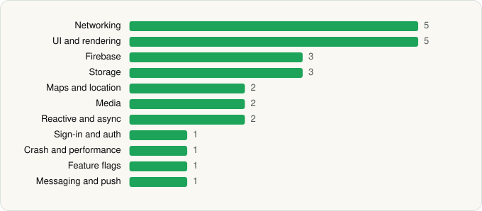

<picture><source media="(prefers-color-scheme: dark)" srcset="../../../../assets/logo/logo-dark.svg"></picture> [Tech Stack](../../../../README.md) / [JPMorgan Chase](../../../../companies/jpmorgan-chase.md) / Chase Mobile

# Chase Mobile

<picture><source media="(prefers-color-scheme: dark)" srcset="../../../../assets/badges/android-dark.svg"></picture> <picture><source media="(prefers-color-scheme: dark)" srcset="../../../../assets/badges/inactive-dark.svg"></picture> <picture><source media="(prefers-color-scheme: dark)" srcset="../../../../assets/badges/floor-dark.svg"></picture>

[Google Play](https://play.google.com/store/apps/details?id=com.chase.sig.android) · [latest.json](latest.json)

| | |
|---|---|
| Company | [JPMorgan Chase](../../../../companies/jpmorgan-chase.md) |
| Store id | `com.chase.sig.android` |
| Bundle / package id | `com.chase.sig.android` |
| Latest version | 4.662 (analysed 2026-06-23) |
| Versions tracked | 1 |
| SDKs in latest version | 26 |
| Languages | C/C++ (native), Java, Kotlin |
| UI | Coil, Glide, Jetpack Compose, Material Components, Picasso |
| Build | Gradle (inferred), R8 / ProGuard (name obfuscation detected) |
| Minimum OS | API 29, targets API 35 |
| Devices / ABIs | Android |
| Capabilities | 12 |
| Declares tracking | Yes |
| Tracked | No. Kept for history. |

## SDKs by category

<picture><source media="(prefers-color-scheme: dark)" srcset="../../../../assets/charts/apps/android/jpmorgan-chase/chase-mobile-dark.svg"></picture>

- **Networking** (5): Cronet, Cronet (Google), OkHttp, Retrofit, Volley
- **UI and rendering** (5): Coil, Glide, Jetpack Compose, Material Components, Picasso
- **Firebase** (3): Firebase, Google DataTransport, Google Play services
- **Storage** (3): DataStore, Okio, Room
- **Maps and location** (2): Google Location, Google Maps
- **Media** (2): ExoPlayer, Media3 (ExoPlayer)
- **Reactive and async** (2): Kotlin Coroutines, RxJava
- **Sign-in and auth** (1): Google Sign-In / Auth
- **Crash and performance** (1): Bugsnag
- **Feature flags** (1): Split
- **Messaging and push** (1): Firebase Messaging

Capabilities (12)

Approximate location, Biometric auth, Bluetooth, Camera, Contacts (read), Fingerprint auth, Microphone, NFC, Notifications, Precise location, Query all installed apps, Storage (read)

## Version history

| Version | Analysed | Store update | SDKs | Change | SDK list is a floor | Binary encrypted | File |
|---|---|---|---|---|---|---|---|
| 4.662 | 2026-06-23 |  | 26 |  | Yes | No | [4.662.json](4.662.json) |

## Model-written summary

> Obfuscated Android banking app in Kotlin/Java with Jetpack Compose, 19 native libs for document scanning, Bugsnag root detection, Split, and Yodlee auth

Written by a language model from the detected signals (`inferred[]`). It is commentary, not measurement.

---

Generated by `scripts/build_readme.py` from the JSON files. Do not edit by hand.
