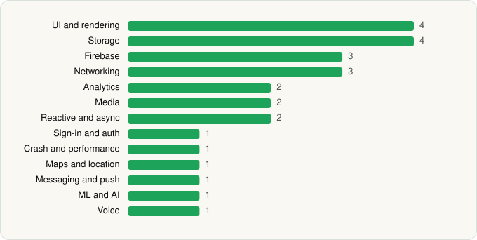

<picture><source media="(prefers-color-scheme: dark)" srcset="../../../../assets/logo/logo-dark.svg"></picture> [Tech Stack](../../../../README.md) / [Karmalab Inc.](../../../../companies/karmalab-inc.md) / KARMA Secure Messenger

# KARMA Secure Messenger

<picture><source media="(prefers-color-scheme: dark)" srcset="../../../../assets/badges/android-dark.svg"></picture> <picture><source media="(prefers-color-scheme: dark)" srcset="../../../../assets/badges/inactive-dark.svg"></picture> <picture><source media="(prefers-color-scheme: dark)" srcset="../../../../assets/badges/floor-dark.svg"></picture>

[Google Play](https://play.google.com/store/apps/details?id=me.karmalab.talk) · [latest.json](latest.json)

| | |
|---|---|
| Company | [Karmalab Inc.](../../../../companies/karmalab-inc.md) |
| Store id | `me.karmalab.talk` |
| Bundle / package id | `me.karmalab.talk` |
| Latest version | 0.9.8.0 (analysed 2026-06-19) |
| Versions tracked | 1 |
| SDKs in latest version | 26 |
| Languages | C/C++ (native), Java, Kotlin |
| UI | Glide, Lottie, Material Components, Picasso |
| Build | Gradle (inferred), R8 / ProGuard (name obfuscation detected) |
| Minimum OS | API 23, targets API 35 |
| Devices / ABIs | Android |
| Capabilities | 15 |
| Declares tracking | Yes |
| Tracked | No. Kept for history. |

## SDKs by category

<picture><source media="(prefers-color-scheme: dark)" srcset="../../../../assets/charts/apps/android/karmalab-inc/karma-secure-messenger-dark.svg"></picture>

- **UI and rendering** (4): Glide, Lottie, Material Components, Picasso
- **Storage** (4): DataStore, greenDAO, Room, SQLCipher
- **Firebase** (3): Firebase, Google DataTransport, Google Play services
- **Networking** (3): OkHttp, Retrofit, Volley
- **Analytics** (2): Firebase Analytics, Google App Measurement
- **Media** (2): ExoPlayer, FFmpeg
- **Reactive and async** (2): Kotlin Coroutines, RxJava
- **Sign-in and auth** (1): Google Sign-In / Auth
- **Crash and performance** (1): Firebase Crashlytics
- **Maps and location** (1): Google Maps
- **Messaging and push** (1): Firebase Messaging
- **ML and AI** (1): Mobile Vision
- **Voice** (1): WebRTC

Capabilities (15)

Advertising ID, Bluetooth, Camera, Contacts (read), Contacts (write), Draw over other apps, Foreground service, Media: audio, Media: images, Media: video, Microphone, Notifications, Phone / carrier info, Storage (read), Storage (write)

## Version history

| Version | Analysed | Store update | SDKs | Change | SDK list is a floor | Binary encrypted | File |
|---|---|---|---|---|---|---|---|
| 0.9.8.0 | 2026-06-19 |  | 26 |  | Yes | No | [0.9.8.0.json](0.9.8.0.json) |

---

Generated by `scripts/build_readme.py` from the JSON files. Do not edit by hand.
