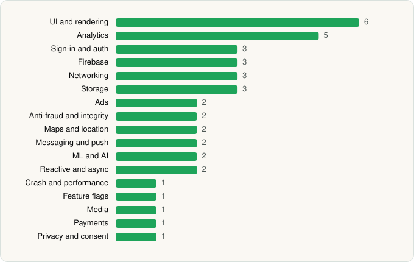

<picture><source media="(prefers-color-scheme: dark)" srcset="../../../../assets/logo/logo-dark.svg"></picture> [Tech Stack](../../../../README.md) / [Kohls](../../../../companies/kohls.md) / Kohl's

# Kohl's - Shopping & More

<picture><source media="(prefers-color-scheme: dark)" srcset="../../../../assets/badges/android-dark.svg"></picture> <picture><source media="(prefers-color-scheme: dark)" srcset="../../../../assets/badges/inactive-dark.svg"></picture> <picture><source media="(prefers-color-scheme: dark)" srcset="../../../../assets/badges/floor-dark.svg"></picture>

[Google Play](https://play.google.com/store/apps/details?id=com.kohls.mcommerce.opal) · [latest.json](latest.json)

| | |
|---|---|
| Company | [Kohls](../../../../companies/kohls.md) |
| Store id | `com.kohls.mcommerce.opal` |
| Bundle / package id | `com.kohls.mcommerce.opal` |
| Latest version | 26.10.5 (analysed 2026-11-03) |
| Versions tracked | 2 |
| SDKs in latest version | 40 |
| Languages | C/C++ (native), Java, Kotlin |
| UI | Coil, Glide, Jetpack Compose, Lottie, Material Components |
| Build | Gradle (inferred), R8 / ProGuard (name obfuscation detected) |
| Minimum OS | API 28, targets API 36 |
| Devices / ABIs | Android |
| Capabilities | 12 |
| Declares tracking | Yes |
| Tracked | No. Kept for history. |

## SDKs by category

<picture><source media="(prefers-color-scheme: dark)" srcset="../../../../assets/charts/apps/android/kohls/kohl-s-dark.svg"></picture>

- **UI and rendering** (6): AndroidSVG, Coil, Glide, Jetpack Compose, Lottie, Material Components
- **Analytics** (5): Adobe Experience Platform, AppsFlyer, Contentsquare, Firebase Analytics, Google App Measurement
- **Sign-in and auth** (3): Auth0, Credential Manager, Google Sign-In / Auth
- **Firebase** (3): Firebase, Google DataTransport, Google Play services
- **Networking** (3): OkHttp, Retrofit, Volley
- **Storage** (3): DataStore, Okio, Room
- **Ads** (2): Google Ad Manager, Google Mobile Ads (AdMob)
- **Anti-fraud and integrity** (2): Play Integrity, reCAPTCHA
- **Maps and location** (2): Google Location, Google Maps
- **Messaging and push** (2): Airship, Firebase Messaging
- **ML and AI** (2): ML Kit, ML Kit (barcode/vision)
- **Reactive and async** (2): Kotlin Coroutines, RxJava
- **Crash and performance** (1): Firebase Crashlytics
- **Feature flags** (1): Firebase Remote Config
- **Media** (1): Media3 (ExoPlayer)
- **Payments** (1): Braintree
- **Privacy and consent** (1): OneTrust

Capabilities (12)

Advertising ID, Approximate location, Biometric auth, Camera, Fingerprint auth, Foreground service, Media: audio, Microphone, Notifications, Phone / carrier info, Precise location, Storage (read)

## Version history

| Version | Analysed | Store update | SDKs | Change | SDK list is a floor | Binary encrypted | File |
|---|---|---|---|---|---|---|---|
| 26.10.5 | 2026-11-03 |  | 40 | +3 / −0 | Yes | No | [26.10.5.json](26.10.5.json) |
| 8.3.56 | 2026-06-19 |  | 37 |  | No | No | [8.3.56.json](8.3.56.json) |

### SDK changes between versions

- 8.3.56 → 26.10.5: added Auth0, Credential Manager, Lottie

---

Generated by `scripts/build_readme.py` from the JSON files. Do not edit by hand.
