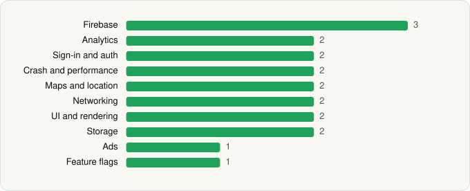

<picture><source media="(prefers-color-scheme: dark)" srcset="../../../../assets/logo/logo-dark.svg"></picture> [Tech Stack](../../../../README.md) / [Lowe's Companies, Inc.](../../../../companies/lowe-s-companies-inc.md) / Lowe's Provider

# Lowe's Provider

<picture><source media="(prefers-color-scheme: dark)" srcset="../../../../assets/badges/android-dark.svg"></picture> <picture><source media="(prefers-color-scheme: dark)" srcset="../../../../assets/badges/inactive-dark.svg"></picture> <picture><source media="(prefers-color-scheme: dark)" srcset="../../../../assets/badges/floor-dark.svg"></picture>

[Google Play](https://play.google.com/store/apps/details?id=com.lowes.serviceproviders) · [latest.json](latest.json)

| | |
|---|---|
| Company | [Lowe's Companies, Inc.](../../../../companies/lowe-s-companies-inc.md) |
| Store id | `com.lowes.serviceproviders` |
| Bundle / package id | `com.lowes.serviceproviders` |
| Latest version | 26.1.13 (analysed 2026-11-21) |
| Versions tracked | 2 |
| SDKs in latest version | 19 |
| Languages | C/C++ (native), Flutter / Dart, Java, Kotlin |
| UI | Jetpack Compose, Material Components |
| Build | Gradle (inferred), Packer/hardening: Google Play (pairip) anti-tamper, R8 / ProGuard (name obfuscation detected) |
| Minimum OS | API 24, targets API 36 |
| Devices / ABIs | Android |
| Capabilities | 7 |
| Declares tracking | Yes |
| Tracked | No. Kept for history. |

## SDKs by category

<picture><source media="(prefers-color-scheme: dark)" srcset="../../../../assets/charts/apps/android/lowe-s-companies-inc/lowe-s-provider-dark.svg"></picture>

- **Firebase** (3): Firebase, Google DataTransport, Google Play services
- **Analytics** (2): Firebase Analytics, Google App Measurement
- **Sign-in and auth** (2): AppAuth, Google Sign-In / Auth
- **Crash and performance** (2): Firebase Crashlytics, Firebase Performance
- **Maps and location** (2): Google Location, Google Maps
- **Networking** (2): Cronet, Cronet (Google)
- **UI and rendering** (2): Jetpack Compose, Material Components
- **Storage** (2): DataStore, Room
- **Ads** (1): Google Mobile Ads (AdMob)
- **Feature flags** (1): Firebase Remote Config

Capabilities (7)

Advertising ID, Approximate location, Foreground service, Notifications, Phone / carrier info, Precise location, Storage (write)

## Version history

| Version | Analysed | Store update | SDKs | Change | SDK list is a floor | Binary encrypted | File |
|---|---|---|---|---|---|---|---|
| 26.1.13 | 2026-11-21 |  | 19 | +4 / −0 | Yes | No | [26.1.13.json](26.1.13.json) |
| 1.41.3 | 2026-06-19 |  | 15 |  | Yes | No | [1.41.3.json](1.41.3.json) |

### SDK changes between versions

- 1.41.3 → 26.1.13: added Firebase Performance, Google Mobile Ads (AdMob), Jetpack Compose, Room

---

Generated by `scripts/build_readme.py` from the JSON files. Do not edit by hand.
