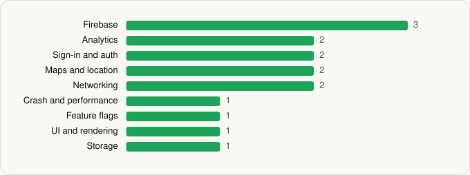

<picture><source media="(prefers-color-scheme: dark)" srcset="../../../../assets/logo/logo-dark.svg"></picture> [Tech Stack](../../../../README.md) / [Lowe's Companies, Inc.](../../../../companies/lowe-s-companies-inc.md) / Lowe's Provider

# Lowe's Provider

<picture><source media="(prefers-color-scheme: dark)" srcset="../../../../assets/badges/android-dark.svg"></picture> <picture><source media="(prefers-color-scheme: dark)" srcset="../../../../assets/badges/inactive-dark.svg"></picture> <picture><source media="(prefers-color-scheme: dark)" srcset="../../../../assets/badges/floor-dark.svg"></picture>

[Google Play](https://play.google.com/store/apps/details?id=com.lowes.serviceproviders) · [latest.json](latest.json)

| | |
|---|---|
| Company | [Lowe's Companies, Inc.](../../../../companies/lowe-s-companies-inc.md) |
| Store id | `com.lowes.serviceproviders` |
| Bundle / package id | `com.lowes.serviceproviders` |
| Latest version | 1.41.3 (analysed 2026-06-19) |
| Versions tracked | 1 |
| SDKs in latest version | 15 |
| Languages | C/C++ (native), Flutter / Dart, Java |
| UI | Material Components |
| Build | Gradle (inferred), R8 / ProGuard (name obfuscation detected) |
| Minimum OS | API 24, targets API 36 |
| Devices / ABIs | Android |
| Capabilities | 8 |
| Declares tracking | Yes |
| Tracked | No. Kept for history. |

## SDKs by category

<picture><source media="(prefers-color-scheme: dark)" srcset="../../../../assets/charts/apps/android/lowe-s-companies-inc/lowe-s-provider-dark.svg"></picture>

- **Firebase** (3): Firebase, Google DataTransport, Google Play services
- **Analytics** (2): Firebase Analytics, Google App Measurement
- **Sign-in and auth** (2): AppAuth, Google Sign-In / Auth
- **Maps and location** (2): Google Location, Google Maps
- **Networking** (2): Cronet, Cronet (Google)
- **Crash and performance** (1): Firebase Crashlytics
- **Feature flags** (1): Firebase Remote Config
- **UI and rendering** (1): Material Components
- **Storage** (1): DataStore

Capabilities (8)

Advertising ID, Approximate location, Media: audio, Media: images, Media: video, Precise location, Storage (read), Storage (write)

## Version history

| Version | Analysed | Store update | SDKs | Change | SDK list is a floor | Binary encrypted | File |
|---|---|---|---|---|---|---|---|
| 1.41.3 | 2026-06-19 |  | 15 |  | Yes | No | [1.41.3.json](1.41.3.json) |

---

Generated by `scripts/build_readme.py` from the JSON files. Do not edit by hand.
