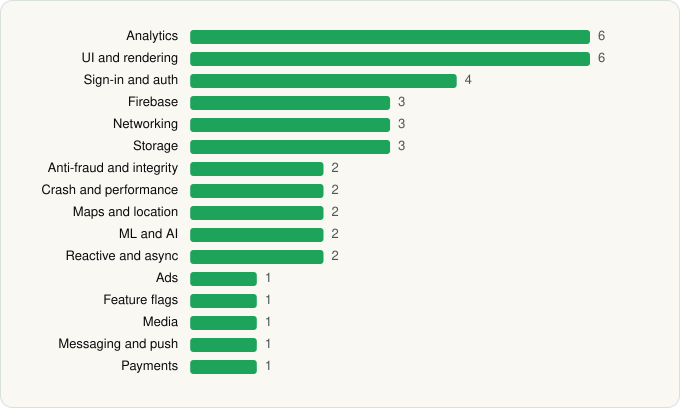

<picture><source media="(prefers-color-scheme: dark)" srcset="../../../../assets/logo/logo-dark.svg"></picture> [Tech Stack](../../../../README.md) / [Lowe's Companies, Inc.](../../../../companies/lowe-s-companies-inc.md) / Lowe's

# Lowe's

<picture><source media="(prefers-color-scheme: dark)" srcset="../../../../assets/badges/android-dark.svg"></picture> <picture><source media="(prefers-color-scheme: dark)" srcset="../../../../assets/badges/inactive-dark.svg"></picture>

[Google Play](https://play.google.com/store/apps/details?id=com.lowes.android) · [latest.json](latest.json)

| | |
|---|---|
| Company | [Lowe's Companies, Inc.](../../../../companies/lowe-s-companies-inc.md) |
| Store id | `com.lowes.android` |
| Bundle / package id | `com.lowes.android` |
| Latest version | 26.10.7 (analysed 2026-11-20) |
| Versions tracked | 2 |
| SDKs in latest version | 40 |
| Languages | C/C++ (native), Java, Kotlin |
| UI | Coil, Glide, Jetpack Compose, Lottie, Material Components |
| Build | Gradle (inferred) |
| Minimum OS | API 32, targets API 37 |
| Devices / ABIs | Android |
| Capabilities | 15 |
| Declares tracking | Yes |
| Tracked | No. Kept for history. |

## SDKs by category

<picture><source media="(prefers-color-scheme: dark)" srcset="../../../../assets/charts/apps/android/lowe-s-companies-inc/lowe-s-dark.svg"></picture>

- **Analytics** (6): AppsFlyer, Branch, Firebase Analytics, FullStory, Google App Measurement, Medallia
- **UI and rendering** (6): AndroidSVG, Coil, Glide, Jetpack Compose, Lottie, Material Components
- **Sign-in and auth** (4): AppAuth, Credential Manager, Firebase Auth, Google Sign-In / Auth
- **Firebase** (3): Firebase, Google DataTransport, Google Play services
- **Networking** (3): Ktor, OkHttp, Retrofit
- **Storage** (3): DataStore, Okio, Room
- **Anti-fraud and integrity** (2): Play Integrity, reCAPTCHA
- **Crash and performance** (2): Firebase Crashlytics, Firebase Performance
- **Maps and location** (2): Google Location, Google Maps
- **ML and AI** (2): ML Kit, ML Kit (barcode/vision)
- **Reactive and async** (2): Kotlin Coroutines, RxJava
- **Ads** (1): Google Mobile Ads (AdMob)
- **Feature flags** (1): Firebase Remote Config
- **Media** (1): Media3 (ExoPlayer)
- **Messaging and push** (1): Firebase Messaging
- **Payments** (1): Braintree

Capabilities (15)

Advertising ID, Approximate location, Background location, Biometric auth, Camera, Fingerprint auth, Foreground service, Foreground service: location, Microphone, NFC, Notifications, Phone / carrier info, Precise location, Storage (read), Storage (write)

## Version history

| Version | Analysed | Store update | SDKs | Change | SDK list is a floor | Binary encrypted | File |
|---|---|---|---|---|---|---|---|
| 26.10.7 | 2026-11-20 |  | 40 | +3 / −1 | No | No | [26.10.7.json](26.10.7.json) |
| 25.4.4 | 2026-06-19 |  | 38 |  | No | No | [25.4.4.json](25.4.4.json) |

### SDK changes between versions

- 25.4.4 → 26.10.7: added AndroidSVG, AppsFlyer, Ktor; removed Picasso

---

Generated by `scripts/build_readme.py` from the JSON files. Do not edit by hand.
