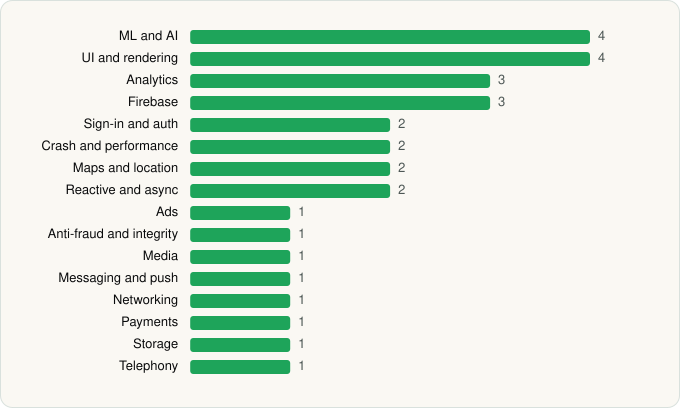

<picture><source media="(prefers-color-scheme: dark)" srcset="../../../../assets/logo/logo-dark.svg"></picture> [Tech Stack](../../../../README.md) / [Lyft, Inc.](../../../../companies/lyft-inc.md) / Lyft

# Lyft

<picture><source media="(prefers-color-scheme: dark)" srcset="../../../../assets/badges/android-dark.svg"></picture> <picture><source media="(prefers-color-scheme: dark)" srcset="../../../../assets/badges/inactive-dark.svg"></picture>

[Google Play](https://play.google.com/store/apps/details?id=me.lyft.android) · [latest.json](latest.json)

| | |
|---|---|
| Company | [Lyft, Inc.](../../../../companies/lyft-inc.md) |
| Store id | `me.lyft.android` |
| Bundle / package id | `me.lyft.android` |
| Latest version | 2026.21.3.1780471452 (analysed 2026-06-19) |
| Versions tracked | 1 |
| SDKs in latest version | 30 |
| Languages | C/C++ (native), Java, Kotlin |
| UI | Glide, Jetpack Compose, Lottie, Material Components |
| Build | Gradle (inferred) |
| Minimum OS | API 29, targets API 36 |
| Devices / ABIs | Android |
| Capabilities | 21 |
| Declares tracking | Yes |
| Tracked | No. Kept for history. |

## SDKs by category

<picture><source media="(prefers-color-scheme: dark)" srcset="../../../../assets/charts/apps/android/lyft-inc/lyft-dark.svg"></picture>

- **ML and AI** (4): ML Kit, Mobile Vision, TensorFlow, TensorFlow Lite
- **UI and rendering** (4): Glide, Jetpack Compose, Lottie, Material Components
- **Analytics** (3): Firebase Analytics, Google App Measurement, Singular
- **Firebase** (3): Firebase, Google DataTransport, Google Play services
- **Sign-in and auth** (2): Credential Manager, Google Sign-In / Auth
- **Crash and performance** (2): Sentry, Sentry (native)
- **Maps and location** (2): Google Location, Google Maps
- **Reactive and async** (2): Kotlin Coroutines, RxJava
- **Ads** (1): Google Mobile Ads (AdMob)
- **Anti-fraud and integrity** (1): Play Integrity
- **Media** (1): Media3 (ExoPlayer)
- **Messaging and push** (1): Firebase Messaging
- **Networking** (1): OkHttp
- **Payments** (1): Braintree
- **Storage** (1): Room
- **Telephony** (1): libphonenumber

Capabilities (21)

Advertising ID, Approximate location, Biometric auth, Bluetooth, Bluetooth (scan), Calendar (read), Camera, Contacts (read), Draw over other apps, Fingerprint auth, Foreground service, Foreground service: location, Foreground service: microphone, Media: audio, Microphone, NFC, Notifications, Phone / carrier info, Precise location, Storage (read), Storage (write)

## Version history

| Version | Analysed | Store update | SDKs | Change | SDK list is a floor | Binary encrypted | File |
|---|---|---|---|---|---|---|---|
| 2026.21.3.1780471452 | 2026-06-19 |  | 30 |  | No | No | [2026.21.3.1780471452.json](2026.21.3.1780471452.json) |

---

Generated by `scripts/build_readme.py` from the JSON files. Do not edit by hand.
