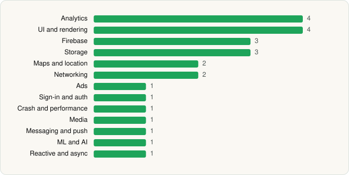

<picture><source media="(prefers-color-scheme: dark)" srcset="../../../../assets/logo/logo-dark.svg"></picture> [Tech Stack](../../../../README.md) / [Marriott International](../../../../companies/marriott-international.md) / Marriott Bonvoy

# Marriott Bonvoy: Book Hotels

<picture><source media="(prefers-color-scheme: dark)" srcset="../../../../assets/badges/android-dark.svg"></picture> <picture><source media="(prefers-color-scheme: dark)" srcset="../../../../assets/badges/inactive-dark.svg"></picture>

[Google Play](https://play.google.com/store/apps/details?id=com.marriott.mrt) · [latest.json](latest.json)

| | |
|---|---|
| Company | [Marriott International](../../../../companies/marriott-international.md) |
| Store id | `com.marriott.mrt` |
| Bundle / package id | `com.marriott.mrt` |
| Latest version | 10.68.0 (analysed 2026-06-28) |
| Versions tracked | 1 |
| SDKs in latest version | 25 |
| Languages | C/C++ (native), Java, Kotlin |
| UI | Glide, Jetpack Compose, Lottie, Material Components |
| Build | Gradle (inferred) |
| Minimum OS | API 29, targets API 36 |
| Devices / ABIs | Android |
| Capabilities | 15 |
| Declares tracking | Yes |
| Tracked | No. Kept for history. |

## SDKs by category

<picture><source media="(prefers-color-scheme: dark)" srcset="../../../../assets/charts/apps/android/marriott-international/marriott-bonvoy-dark.svg"></picture>

- **Analytics** (4): Branch, Firebase Analytics, Google App Measurement, Mixpanel
- **UI and rendering** (4): Glide, Jetpack Compose, Lottie, Material Components
- **Firebase** (3): Firebase, Google DataTransport, Google Play services
- **Storage** (3): Okio, Room, SQLCipher
- **Maps and location** (2): Google Location, Google Maps
- **Networking** (2): OkHttp, Retrofit
- **Ads** (1): Google Mobile Ads (AdMob)
- **Sign-in and auth** (1): Google Sign-In / Auth
- **Crash and performance** (1): Embrace
- **Media** (1): Media3 (ExoPlayer)
- **Messaging and push** (1): Firebase Messaging
- **ML and AI** (1): ML Kit
- **Reactive and async** (1): Kotlin Coroutines

Capabilities (15)

Advertising ID, Approximate location, Biometric auth, Bluetooth, Bluetooth (connect), Bluetooth (scan), Calendar (write), Camera, Fingerprint auth, Foreground service, Microphone, NFC, Notifications, Precise location, Storage (read)

## Version history

| Version | Analysed | Store update | SDKs | Change | SDK list is a floor | Binary encrypted | File |
|---|---|---|---|---|---|---|---|
| 10.68.0 | 2026-06-28 |  | 25 |  | No | No | [10.68.0.json](10.68.0.json) |

---

Generated by `scripts/build_readme.py` from the JSON files. Do not edit by hand.
