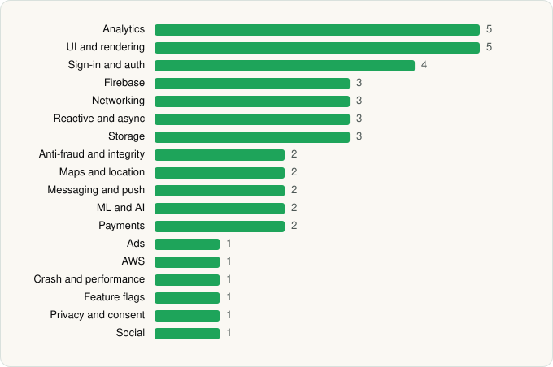

<picture><source media="(prefers-color-scheme: dark)" srcset="../../../../assets/logo/logo-dark.svg"></picture> [Tech Stack](../../../../README.md) / [McDonalds USA, LLC](../../../../companies/mcdonalds-usa-llc.md) / McDonald's

# McDonald's

<picture><source media="(prefers-color-scheme: dark)" srcset="../../../../assets/badges/android-dark.svg"></picture> <picture><source media="(prefers-color-scheme: dark)" srcset="../../../../assets/badges/inactive-dark.svg"></picture>

[Google Play](https://play.google.com/store/apps/details?id=com.mcdonalds.app) · [latest.json](latest.json)

| | |
|---|---|
| Company | [McDonalds USA, LLC](../../../../companies/mcdonalds-usa-llc.md) |
| Store id | `com.mcdonalds.app` |
| Bundle / package id | `com.mcdonalds.app` |
| Latest version | 26.72.5 (analysed 2026-11-04) |
| Versions tracked | 2 |
| SDKs in latest version | 42 |
| Languages | C/C++ (native), Java, Kotlin |
| UI | Coil, Glide, Jetpack Compose, Lottie, Material Components |
| Build | Gradle (inferred) |
| Minimum OS | API 28, targets API 36 |
| Devices / ABIs | Android |
| Capabilities | 13 |
| Declares tracking | Yes |
| Tracked | No. Kept for history. |

## SDKs by category

<picture><source media="(prefers-color-scheme: dark)" srcset="../../../../assets/charts/apps/android/mcdonalds-usa-llc/mcdonald-s-dark.svg"></picture>

- **Analytics** (5): Facebook SDK, Firebase Analytics, Google Analytics (legacy), Google App Measurement, Kochava
- **UI and rendering** (5): Coil, Glide, Jetpack Compose, Lottie, Material Components
- **Sign-in and auth** (4): Credential Manager, Facebook Login, Firebase Auth, Google Sign-In / Auth
- **Firebase** (3): Firebase, Google DataTransport, Google Play services
- **Networking** (3): OkHttp, Retrofit, Volley
- **Reactive and async** (3): Kotlin Coroutines, RxJava, RxJava 3
- **Storage** (3): Okio, Realm, Room
- **Anti-fraud and integrity** (2): Play Integrity, reCAPTCHA
- **Maps and location** (2): Google Location, Google Maps
- **Messaging and push** (2): Braze, Firebase Messaging
- **ML and AI** (2): ML Kit, Mobile Vision
- **Payments** (2): Adyen, Braintree
- **Ads** (1): Google Mobile Ads (AdMob)
- **AWS** (1): AWS Amplify
- **Crash and performance** (1): New Relic
- **Feature flags** (1): Split
- **Privacy and consent** (1): OneTrust
- **Social** (1): Facebook Share

Capabilities (13)

Advertising ID, Approximate location, Biometric auth, Camera, Fingerprint auth, Foreground service, Foreground service: location, Media: audio, Notifications, Phone / carrier info, Precise location, Storage (read), Storage (write)

## Version history

| Version | Analysed | Store update | SDKs | Change | SDK list is a floor | Binary encrypted | File |
|---|---|---|---|---|---|---|---|
| 26.72.5 | 2026-11-04 |  | 42 | +0 / −1 | No | No | [26.72.5.json](26.72.5.json) |
| 26.44.2 | 2026-06-19 |  | 43 |  | No | No | [26.44.2.json](26.44.2.json) |

### SDK changes between versions

- 26.44.2 → 26.72.5: removed Adobe Experience Platform

---

Generated by `scripts/build_readme.py` from the JSON files. Do not edit by hand.
