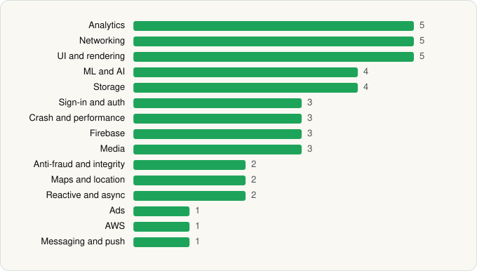

<picture><source media="(prefers-color-scheme: dark)" srcset="../../../../assets/logo/logo-dark.svg"></picture> [Tech Stack](../../../../README.md) / [Mercado Libre](../../../../companies/mercado-libre.md) / Mercado Libre

# Mercado Libre: Compras online

<picture><source media="(prefers-color-scheme: dark)" srcset="../../../../assets/badges/android-dark.svg"></picture> <picture><source media="(prefers-color-scheme: dark)" srcset="../../../../assets/badges/inactive-dark.svg"></picture>

[Google Play](https://play.google.com/store/apps/details?id=com.mercadolibre) · [latest.json](latest.json)

| | |
|---|---|
| Company | [Mercado Libre](../../../../companies/mercado-libre.md) |
| Store id | `com.mercadolibre` |
| Bundle / package id | `com.mercadolibre` |
| Latest version | 10.589.2 (analysed 2026-11-14) |
| Versions tracked | 1 |
| SDKs in latest version | 44 |
| Languages | C/C++ (native), Java, Kotlin |
| UI | Glide, Jetpack Compose, Lottie, Material Components |
| Build | Gradle (inferred) |
| Minimum OS | API 23, targets API 36 |
| Devices / ABIs | Android |
| Capabilities | 21 |
| Declares tracking | Yes |
| Tracked | No. Kept for history. |

## SDKs by category

<picture><source media="(prefers-color-scheme: dark)" srcset="../../../../assets/charts/apps/android/mercado-libre/mercado-libre-dark.svg"></picture>

- **Analytics** (5): Adjust, Facebook SDK, Firebase Analytics, Google Analytics (legacy), Google App Measurement
- **Networking** (5): Cronet, Cronet (Google), OkHttp, Retrofit, Volley
- **UI and rendering** (5): AndroidSVG, Glide, Jetpack Compose, Lottie, Material Components
- **ML and AI** (4): ML Kit, Mobile Vision, TensorFlow, TensorFlow Lite
- **Storage** (4): DataStore, MMKV, Okio, Room
- **Sign-in and auth** (3): Credential Manager, Facebook Login, Google Sign-In / Auth
- **Crash and performance** (3): Bugsnag, Datadog, OpenTelemetry
- **Firebase** (3): Firebase, Google DataTransport, Google Play services
- **Media** (3): Bitmovin, Google Cast, Media3 (ExoPlayer)
- **Anti-fraud and integrity** (2): Play Integrity, reCAPTCHA
- **Maps and location** (2): Google Location, Google Maps
- **Reactive and async** (2): Kotlin Coroutines, RxJava
- **Ads** (1): Google Mobile Ads (AdMob)
- **AWS** (1): AWS SDK
- **Messaging and push** (1): Firebase Messaging

Capabilities (21)

Advertising ID, Approximate location, Biometric auth, Bluetooth, Bluetooth (connect), Camera, Contacts (read), Contacts (write), Draw over other apps, Fingerprint auth, Foreground service, Foreground service: media playback, Foreground service: microphone, Media: audio, Microphone, NFC, Notifications, Precise location, Query all installed apps, Storage (read), Storage (write)

## Version history

| Version | Analysed | Store update | SDKs | Change | SDK list is a floor | Binary encrypted | File |
|---|---|---|---|---|---|---|---|
| 10.589.2 | 2026-11-14 |  | 44 |  | No | No | [10.589.2.json](10.589.2.json) |

---

Generated by `scripts/build_readme.py` from the JSON files. Do not edit by hand.
