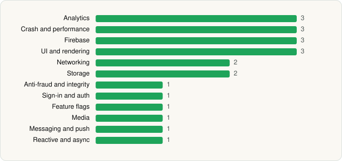

<picture><source media="(prefers-color-scheme: dark)" srcset="../../../../assets/logo/logo-dark.svg"></picture> [Tech Stack](../../../../README.md) / [Mercari, Inc](../../../../companies/mercari-inc.md) / Mercari Japan

# Mercari Japan: Anime Shopping

<picture><source media="(prefers-color-scheme: dark)" srcset="../../../../assets/badges/android-dark.svg"></picture> <picture><source media="(prefers-color-scheme: dark)" srcset="../../../../assets/badges/inactive-dark.svg"></picture> <picture><source media="(prefers-color-scheme: dark)" srcset="../../../../assets/badges/floor-dark.svg"></picture>

[Google Play](https://play.google.com/store/apps/details?id=com.mercari.global) · [latest.json](latest.json)

| | |
|---|---|
| Company | [Mercari, Inc](../../../../companies/mercari-inc.md) |
| Store id | `com.mercari.global` |
| Bundle / package id | `com.mercari.global` |
| Latest version | 1.49.0 (analysed 2026-06-19) |
| Versions tracked | 1 |
| SDKs in latest version | 22 |
| Languages | C/C++ (native), Java, Kotlin |
| UI | Coil, Jetpack Compose, Material Components |
| Build | Gradle (inferred), R8 / ProGuard (name obfuscation detected) |
| Minimum OS | API 32, targets API 35 |
| Devices / ABIs | Android |
| Capabilities | 4 |
| Declares tracking | Yes |
| Tracked | No. Kept for history. |

## SDKs by category

<picture><source media="(prefers-color-scheme: dark)" srcset="../../../../assets/charts/apps/android/mercari-inc/mercari-japan-dark.svg"></picture>

- **Analytics** (3): AppsFlyer, Firebase Analytics, Google App Measurement
- **Crash and performance** (3): Datadog, Firebase Crashlytics, Firebase Performance
- **Firebase** (3): Firebase, Google DataTransport, Google Play services
- **UI and rendering** (3): Coil, Jetpack Compose, Material Components
- **Networking** (2): OkHttp, Retrofit
- **Storage** (2): DataStore, Room
- **Anti-fraud and integrity** (1): Play Integrity
- **Sign-in and auth** (1): Google Sign-In / Auth
- **Feature flags** (1): Firebase Remote Config
- **Media** (1): Media3 (ExoPlayer)
- **Messaging and push** (1): Firebase Messaging
- **Reactive and async** (1): Kotlin Coroutines

Capabilities (4)

Advertising ID, Camera, Foreground service, Notifications

## Version history

| Version | Analysed | Store update | SDKs | Change | SDK list is a floor | Binary encrypted | File |
|---|---|---|---|---|---|---|---|
| 1.49.0 | 2026-06-19 |  | 22 |  | Yes | No | [1.49.0.json](1.49.0.json) |

## Model-written summary

> Android Mercari Japan app using Kotlin, Jetpack Compose, custom native image libs, dual Datadog/Firebase monitoring, and first-party Mercari backends

Written by a language model from the detected signals (`inferred[]`). It is commentary, not measurement.

---

Generated by `scripts/build_readme.py` from the JSON files. Do not edit by hand.
