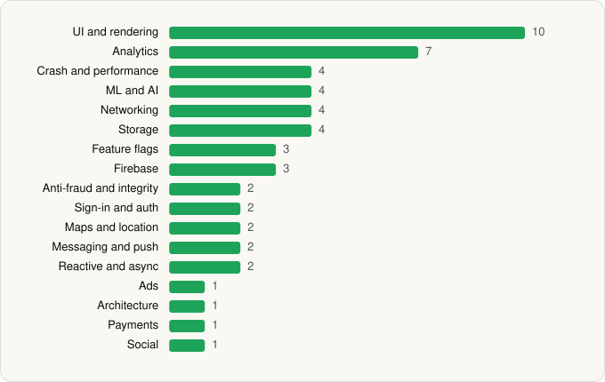

<picture><source media="(prefers-color-scheme: dark)" srcset="../../../../assets/logo/logo-dark.svg"></picture> [Tech Stack](../../../../README.md) / [Mercari, Inc](../../../../companies/mercari-inc.md) / Mercari

# Mercari: Buy and Sell App

<picture><source media="(prefers-color-scheme: dark)" srcset="../../../../assets/badges/android-dark.svg"></picture> <picture><source media="(prefers-color-scheme: dark)" srcset="../../../../assets/badges/inactive-dark.svg"></picture>

[Google Play](https://play.google.com/store/apps/details?id=com.mercariapp.mercari) · [latest.json](latest.json)

| | |
|---|---|
| Company | [Mercari, Inc](../../../../companies/mercari-inc.md) |
| Store id | `com.mercariapp.mercari` |
| Bundle / package id | `com.mercariapp.mercari` |
| Latest version | 9.46.2 (analysed 2026-11-04) |
| Versions tracked | 2 |
| SDKs in latest version | 55 |
| Languages | C/C++ (native), Java, Kotlin, React Native / JavaScript |
| UI | Coil, Fresco, Glide, Jetpack Compose, Lottie, Material Components |
| Build | Gradle (inferred) |
| Minimum OS | API 25, targets API 36 |
| Devices / ABIs | Android |
| Capabilities | 12 |
| Declares tracking | Yes |
| Tracked | No. Kept for history. |

## SDKs by category

<picture><source media="(prefers-color-scheme: dark)" srcset="../../../../assets/charts/apps/android/mercari-inc/mercari-dark.svg"></picture>

- **UI and rendering** (10): AndroidSVG, Coil, FlashList, Fresco, Glide, Jetpack Compose, Lottie, Material Components, React Native Reanimated, react-native-svg
- **Analytics** (7): Adjust, Amplitude, AppsFlyer, Branch, Facebook SDK, Firebase Analytics, Google App Measurement
- **Crash and performance** (4): Firebase Crashlytics, Firebase Performance, Sentry, Sentry (native)
- **ML and AI** (4): ML Kit, ML Kit (barcode/vision), TensorFlow, TensorFlow Lite
- **Networking** (4): axios, OkHttp, Retrofit, Volley
- **Storage** (4): DataStore, MMKV, Okio, Room
- **Anti-fraud and integrity** (3): Fingerprint, Play Integrity, reCAPTCHA
- **Sign-in and auth** (3): Credential Manager, Facebook Login, Google Sign-In / Auth
- **Feature flags** (3): Firebase Remote Config, LaunchDarkly, Statsig
- **Firebase** (3): Firebase, Google DataTransport, Google Play services
- **Maps and location** (2): Google Location, Google Maps
- **Messaging and push** (2): Braze, Firebase Messaging
- **Reactive and async** (2): Kotlin Coroutines, RxJava
- **Ads** (1): Google Mobile Ads (AdMob)
- **Architecture** (1): Redux
- **Payments** (1): Braintree
- **Social** (1): Facebook Share

Capabilities (12)

Advertising ID, Biometric auth, Camera, Contacts (read), Fingerprint auth, Foreground service, Media: images, Microphone, NFC, Notifications, Storage (read), Storage (write)

## Version history

| Version | Analysed | Store update | SDKs | Change | SDK list is a floor | Binary encrypted | File |
|---|---|---|---|---|---|---|---|
| 9.46.2 | 2026-11-04 |  | 55 | +3 / −1 | No | No | [9.46.2.json](9.46.2.json) |
| 9.36.0 | 2026-06-19 |  | 53 |  | No | No | [9.36.0.json](9.36.0.json) |

### SDK changes between versions

- 9.36.0 → 9.46.2: added AppsFlyer, Credential Manager, Fingerprint; removed Google Analytics (legacy)

---

Generated by `scripts/build_readme.py` from the JSON files. Do not edit by hand.
