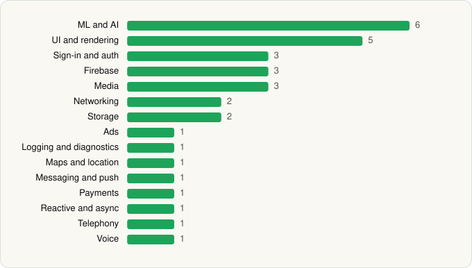

<picture><source media="(prefers-color-scheme: dark)" srcset="../../../../assets/logo/logo-dark.svg"></picture> [Tech Stack](../../../../README.md) / [Meta Platforms, Inc.](../../../../companies/meta-platforms-inc.md) / Meta AI

# Meta AI

<picture><source media="(prefers-color-scheme: dark)" srcset="../../../../assets/badges/android-dark.svg"></picture> <picture><source media="(prefers-color-scheme: dark)" srcset="../../../../assets/badges/active-dark.svg"></picture>

[Google Play](https://play.google.com/store/apps/details?id=com.facebook.stella) · [latest.json](latest.json)

| | |
|---|---|
| Company | [Meta Platforms, Inc.](../../../../companies/meta-platforms-inc.md) |
| Store id | `com.facebook.stella` |
| Bundle / package id | `com.facebook.stella` |
| Latest version | 295.0.0.37.164 (analysed 2026-10-24) |
| Versions tracked | 1 |
| SDKs in latest version | 32 |
| Languages | C/C++ (native), Java, Kotlin |
| UI | Coil, Fresco, Jetpack Compose, Lottie, Material Components |
| Build | Gradle (inferred) |
| Minimum OS | API 29, targets API 36 |
| Devices / ABIs | Android |
| Capabilities | 26 |
| Declares tracking | Yes |
| Tracked | Yes |

## SDKs by category

<picture><source media="(prefers-color-scheme: dark)" srcset="../../../../assets/charts/apps/android/meta-platforms-inc/meta-ai-dark.svg"></picture>

- **ML and AI** (6): MediaPipe, ML Kit, Mobile Vision, PyTorch, TensorFlow, TensorFlow Lite
- **UI and rendering** (5): Coil, Fresco, Jetpack Compose, Lottie, Material Components
- **Sign-in and auth** (3): Auth0, Credential Manager, Google Sign-In / Auth
- **Firebase** (3): Firebase, Google DataTransport, Google Play services
- **Media** (3): ExoPlayer, FFmpeg, Media3 (ExoPlayer)
- **Networking** (2): OkHttp, Retrofit
- **Storage** (2): DataStore, Room
- **Ads** (1): Google Mobile Ads (AdMob)
- **Logging and diagnostics** (1): Flipper
- **Maps and location** (1): Google Location
- **Messaging and push** (1): Firebase Messaging
- **Payments** (1): Google Play Billing
- **Reactive and async** (1): Kotlin Coroutines
- **Telephony** (1): libphonenumber
- **Voice** (1): WebRTC

Capabilities (26)

Activity / fitness recognition, Advertising ID, Approximate location, Background location, Biometric auth, Bluetooth, Bluetooth (connect), Bluetooth (scan), Camera, Contacts (read), Foreground service, Foreground service: location, Foreground service: microphone, Health Connect: heart rate, Health Connect: steps, Media: images, Media: video, Microphone, Notifications, Phone / carrier info, Precise location, SMS (read), SMS (receive), SMS (send), Storage (read), Storage (write)

## Version history

| Version | Analysed | Store update | SDKs | Change | SDK list is a floor | Binary encrypted | File |
|---|---|---|---|---|---|---|---|
| 295.0.0.37.164 | 2026-10-24 | 2026-10-16 | 32 |  | No | No | [295.0.0.37.164.json](295.0.0.37.164.json) |

---

Generated by `scripts/build_readme.py` from the JSON files. Do not edit by hand.
