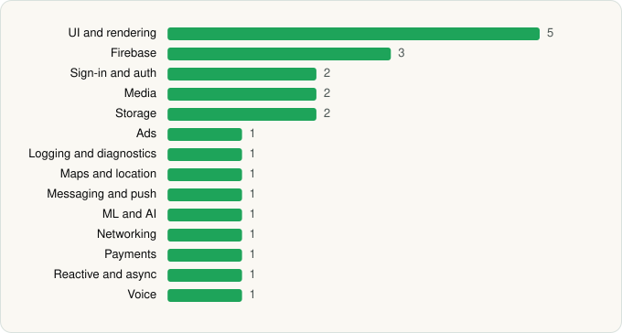

<picture><source media="(prefers-color-scheme: dark)" srcset="../../../../assets/logo/logo-dark.svg"></picture> [Tech Stack](../../../../README.md) / [Meta Platforms, Inc.](../../../../companies/meta-platforms-inc.md) / Muse from Meta

# Muse from Meta

<picture><source media="(prefers-color-scheme: dark)" srcset="../../../../assets/badges/android-dark.svg"></picture> <picture><source media="(prefers-color-scheme: dark)" srcset="../../../../assets/badges/active-dark.svg"></picture>

[Google Play](https://play.google.com/store/apps/details?id=com.facebook.aura) · [latest.json](latest.json)

| | |
|---|---|
| Company | [Meta Platforms, Inc.](../../../../companies/meta-platforms-inc.md) |
| Store id | `com.facebook.aura` |
| Bundle / package id | `com.facebook.aura` |
| Latest version | 14.0.0.4.149 (analysed 2026-11-01) |
| Versions tracked | 1 |
| SDKs in latest version | 23 |
| Languages | C/C++ (native), Java, Kotlin, React Native / JavaScript |
| UI | Fresco, Jetpack Compose, Lottie, Material Components |
| Build | Gradle (inferred) |
| Minimum OS | API 29, targets API 36 |
| Devices / ABIs | Android |
| Capabilities | 25 |
| Declares tracking | Yes |
| Tracked | Yes |

## SDKs by category

<picture><source media="(prefers-color-scheme: dark)" srcset="../../../../assets/charts/apps/android/meta-platforms-inc/muse-from-meta-dark.svg"></picture>

- **UI and rendering** (5): AndroidSVG, Fresco, Jetpack Compose, Lottie, Material Components
- **Firebase** (3): Firebase, Google DataTransport, Google Play services
- **Sign-in and auth** (2): Credential Manager, Google Sign-In / Auth
- **Media** (2): ExoPlayer, Media3 (ExoPlayer)
- **Storage** (2): DataStore, Room
- **Ads** (1): Google Mobile Ads (AdMob)
- **Logging and diagnostics** (1): Flipper
- **Maps and location** (1): Google Location
- **Messaging and push** (1): Firebase Messaging
- **ML and AI** (1): ML Kit
- **Networking** (1): OkHttp
- **Payments** (1): Google Play Billing
- **Reactive and async** (1): Kotlin Coroutines
- **Voice** (1): WebRTC

Capabilities (25)

Advertising ID, Approximate location, Background location, Biometric auth, Bluetooth, Bluetooth (connect), Bluetooth (scan), Calendar (read), Calendar (write), Camera, Contacts (read), Contacts (write), Fingerprint auth, Foreground service, Foreground service: media playback, Foreground service: microphone, Health Connect: heart rate, Health Connect: steps, Media: images, Microphone, Notifications, Precise location, SMS (read), SMS (send), Storage (read)

## Version history

| Version | Analysed | Store update | SDKs | Change | SDK list is a floor | Binary encrypted | File |
|---|---|---|---|---|---|---|---|
| 14.0.0.4.149 | 2026-11-01 | 2026-10-30 | 23 |  | No | No | [14.0.0.4.149.json](14.0.0.4.149.json) |

---

Generated by `scripts/build_readme.py` from the JSON files. Do not edit by hand.
