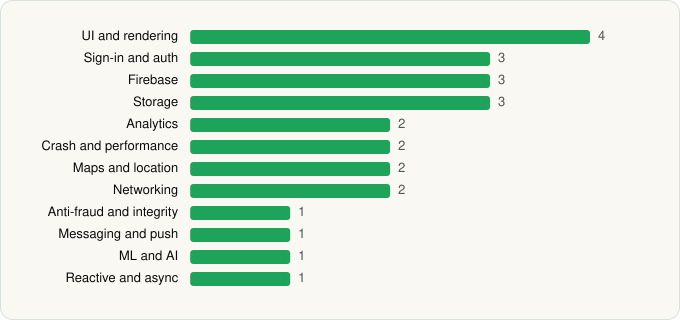

<picture><source media="(prefers-color-scheme: dark)" srcset="../../../../assets/logo/logo-dark.svg"></picture> [Tech Stack](../../../../README.md) / [Microsoft Corporation](../../../../companies/microsoft-corporation.md) / Microsoft Authenticator

# Microsoft Authenticator

<picture><source media="(prefers-color-scheme: dark)" srcset="../../../../assets/badges/android-dark.svg"></picture> <picture><source media="(prefers-color-scheme: dark)" srcset="../../../../assets/badges/inactive-dark.svg"></picture>

[Google Play](https://play.google.com/store/apps/details?id=com.azure.authenticator) · [latest.json](latest.json)

| | |
|---|---|
| Company | [Microsoft Corporation](../../../../companies/microsoft-corporation.md) |
| Store id | `com.azure.authenticator` |
| Bundle / package id | `com.azure.authenticator` |
| Latest version | 6.2611.7348 (analysed 2026-11-06) |
| Versions tracked | 2 |
| SDKs in latest version | 25 |
| Languages | C/C++ (native), Java, Kotlin |
| UI | Jetpack Compose, Lottie, Material Components, Picasso |
| Build | Gradle (inferred) |
| Minimum OS | API 26, targets API 36 |
| Devices / ABIs | Android |
| Capabilities | 11 |
| Declares tracking | Yes |
| Tracked | No. Kept for history. |

## SDKs by category

<picture><source media="(prefers-color-scheme: dark)" srcset="../../../../assets/charts/apps/android/microsoft-corporation/microsoft-authenticator-dark.svg"></picture>

- **UI and rendering** (4): Jetpack Compose, Lottie, Material Components, Picasso
- **Sign-in and auth** (3): AppAuth, Credential Manager, Google Sign-In / Auth
- **Firebase** (3): Firebase, Google DataTransport, Google Play services
- **Storage** (3): DataStore, Okio, Room
- **Analytics** (2): Firebase Analytics, Google App Measurement
- **Crash and performance** (2): App Center, OpenTelemetry
- **Maps and location** (2): Google Location, Google Maps
- **Networking** (2): OkHttp, Retrofit
- **Anti-fraud and integrity** (1): Play Integrity
- **Messaging and push** (1): Firebase Messaging
- **ML and AI** (1): ONNX Runtime
- **Reactive and async** (1): Kotlin Coroutines

Capabilities (11)

Approximate location, Background location, Biometric auth, Camera, Draw over other apps, Fingerprint auth, Foreground service, Foreground service: location, NFC, Notifications, Precise location

## Version history

| Version | Analysed | Store update | SDKs | Change | SDK list is a floor | Binary encrypted | File |
|---|---|---|---|---|---|---|---|
| 6.2611.7348 | 2026-11-06 | 2026-11-05 | 25 | +0 / −0 | No | No | [6.2611.7348.json](6.2611.7348.json) |
| 6.2605.3042 | 2026-06-23 |  | 25 |  | No | No | [6.2605.3042.json](6.2605.3042.json) |

---

Generated by `scripts/build_readme.py` from the JSON files. Do not edit by hand.
