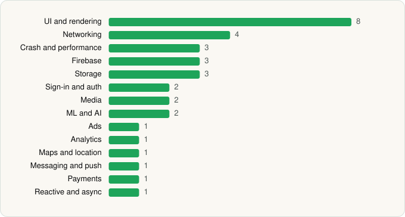

<picture><source media="(prefers-color-scheme: dark)" srcset="../../../../assets/logo/logo-dark.svg"></picture> [Tech Stack](../../../../README.md) / [Microsoft Corporation](../../../../companies/microsoft-corporation.md) / Microsoft Edge

# Microsoft Edge

<picture><source media="(prefers-color-scheme: dark)" srcset="../../../../assets/badges/android-dark.svg"></picture> <picture><source media="(prefers-color-scheme: dark)" srcset="../../../../assets/badges/active-dark.svg"></picture>

[Google Play](https://play.google.com/store/apps/details?id=com.microsoft.emmx) · [latest.json](latest.json)

| | |
|---|---|
| Company | [Microsoft Corporation](../../../../companies/microsoft-corporation.md) |
| Store id | `com.microsoft.emmx` |
| Bundle / package id | `com.microsoft.emmx` |
| Latest version | 148.0.3967.97 (analysed 2026-06-19) |
| Versions tracked | 1 |
| SDKs in latest version | 33 |
| Languages | C/C++ (native), Java, Kotlin |
| UI | Coil, Glide, Jetpack Compose, Lottie, Material Components |
| Build | Gradle (inferred) |
| Minimum OS | API 29, targets API 36 |
| Devices / ABIs | Android |
| Capabilities | 17 |
| Declares tracking | Yes |
| Tracked | Yes |

## SDKs by category

<picture><source media="(prefers-color-scheme: dark)" srcset="../../../../assets/charts/apps/android/microsoft-corporation/microsoft-edge-dark.svg"></picture>

- **UI and rendering** (8): AndroidSVG, Coil, Glide, Jetpack Compose, jLaTeXMath, Lottie, Markwon, Material Components
- **Networking** (4): Cronet, Ktor, OkHttp, Retrofit
- **Crash and performance** (3): App Center, OpenTelemetry, Sentry
- **Firebase** (3): Firebase, Google DataTransport, Google Play services
- **Storage** (3): DataStore, Okio, Room
- **Sign-in and auth** (2): Credential Manager, Google Sign-In / Auth
- **Media** (2): Google Cast, Media3 (ExoPlayer)
- **ML and AI** (2): ML Kit, Mobile Vision
- **Ads** (1): Google Mobile Ads (AdMob)
- **Analytics** (1): Adjust
- **Maps and location** (1): Google Location
- **Messaging and push** (1): Firebase Messaging
- **Payments** (1): Google Play Billing
- **Reactive and async** (1): Kotlin Coroutines

Capabilities (17)

Advertising ID, Approximate location, Biometric auth, Camera, Fingerprint auth, Foreground service, Foreground service: camera, Foreground service: media playback, Foreground service: microphone, Microphone, NFC, Notifications, Precise location, Query all installed apps, SMS (receive), Storage (read), Storage (write)

## Version history

| Version | Analysed | Store update | SDKs | Change | SDK list is a floor | Binary encrypted | File |
|---|---|---|---|---|---|---|---|
| 148.0.3967.97 | 2026-06-19 |  | 33 |  | No | No | [148.0.3967.97.json](148.0.3967.97.json) |

---

Generated by `scripts/build_readme.py` from the JSON files. Do not edit by hand.
