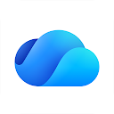
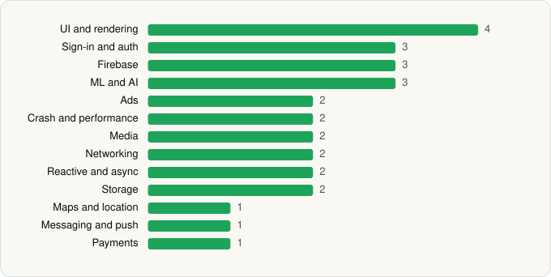

<picture><source media="(prefers-color-scheme: dark)" srcset="../../../../assets/logo/logo-dark.svg"></picture> [Tech Stack](../../../../README.md) / [Microsoft Corporation](../../../../companies/microsoft-corporation.md) / Microsoft OneDrive

# Microsoft OneDrive

<picture><source media="(prefers-color-scheme: dark)" srcset="../../../../assets/badges/android-dark.svg"></picture> <picture><source media="(prefers-color-scheme: dark)" srcset="../../../../assets/badges/inactive-dark.svg"></picture> <picture><source media="(prefers-color-scheme: dark)" srcset="../../../../assets/badges/floor-dark.svg"></picture>

[Google Play](https://play.google.com/store/apps/details?id=com.microsoft.skydrive) · [latest.json](latest.json)

| | |
|---|---|
| Company | [Microsoft Corporation](../../../../companies/microsoft-corporation.md) |
| Store id | `com.microsoft.skydrive` |
| Bundle / package id | `com.microsoft.skydrive` |
| Latest version | 7.56 (analysed 2026-06-19) |
| Versions tracked | 1 |
| SDKs in latest version | 28 |
| Languages | C/C++ (native), Java, Kotlin |
| UI | Glide, Jetpack Compose, Lottie, Material Components |
| Build | Gradle (inferred), R8 / ProGuard (name obfuscation detected) |
| Minimum OS | API 26, targets API 36 |
| Devices / ABIs | Android |
| Capabilities | 14 |
| Declares tracking | Yes |
| Tracked | No. Kept for history. |

## SDKs by category

<picture><source media="(prefers-color-scheme: dark)" srcset="../../../../assets/charts/apps/android/microsoft-corporation/microsoft-onedrive-dark.svg"></picture>

- **UI and rendering** (4): Glide, Jetpack Compose, Lottie, Material Components
- **Sign-in and auth** (3): Credential Manager, Firebase Auth, Google Sign-In / Auth
- **Firebase** (3): Firebase, Google DataTransport, Google Play services
- **ML and AI** (3): ML Kit, TensorFlow, TensorFlow Lite
- **Ads** (2): Google Ad Manager, Google Mobile Ads (AdMob)
- **Crash and performance** (2): App Center, OpenTelemetry
- **Media** (2): Google Cast, Media3 (ExoPlayer)
- **Networking** (2): OkHttp, Retrofit
- **Reactive and async** (2): Kotlin Coroutines, RxJava
- **Storage** (2): DataStore, Room
- **Maps and location** (1): Google Maps
- **Messaging and push** (1): Firebase Messaging
- **Payments** (1): Google Play Billing

Capabilities (14)

Biometric auth, Camera, Contacts (read), Fingerprint auth, Foreground service, Foreground service: media playback, Media: audio, Media: images, Media: video, Microphone, NFC, Notifications, Storage (read), Storage (write)

## Version history

| Version | Analysed | Store update | SDKs | Change | SDK list is a floor | Binary encrypted | File |
|---|---|---|---|---|---|---|---|
| 7.56 | 2026-06-19 |  | 28 |  | Yes | No | [7.56.json](7.56.json) |

---

Generated by `scripts/build_readme.py` from the JSON files. Do not edit by hand.
