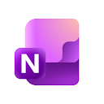
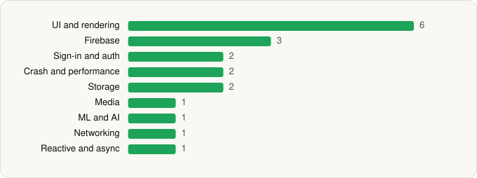

<picture><source media="(prefers-color-scheme: dark)" srcset="../../../../assets/logo/logo-dark.svg"></picture> [Tech Stack](../../../../README.md) / [Microsoft Corporation](../../../../companies/microsoft-corporation.md) / Microsoft OneNote

# Microsoft OneNote: Save Notes

<picture><source media="(prefers-color-scheme: dark)" srcset="../../../../assets/badges/android-dark.svg"></picture> <picture><source media="(prefers-color-scheme: dark)" srcset="../../../../assets/badges/inactive-dark.svg"></picture>

[Google Play](https://play.google.com/store/apps/details?id=com.microsoft.office.onenote) · [latest.json](latest.json)

| | |
|---|---|
| Company | [Microsoft Corporation](../../../../companies/microsoft-corporation.md) |
| Store id | `com.microsoft.office.onenote` |
| Bundle / package id | `com.microsoft.office.onenote` |
| Latest version | 16.0.19127.20320 (analysed 2026-06-19) |
| Versions tracked | 1 |
| SDKs in latest version | 19 |
| Languages | C/C++ (native), Java, Kotlin |
| UI | Coil, Glide, Jetpack Compose, Lottie, Material Components |
| Build | Gradle (inferred) |
| Minimum OS | API 28, targets API 34 |
| Devices / ABIs | Android |
| Capabilities | 13 |
| Declares tracking | No |
| Tracked | No. Kept for history. |

## SDKs by category

<picture><source media="(prefers-color-scheme: dark)" srcset="../../../../assets/charts/apps/android/microsoft-corporation/microsoft-onenote-dark.svg"></picture>

- **UI and rendering** (6): Coil, Glide, Jetpack Compose, Lottie, Markwon, Material Components
- **Firebase** (3): Firebase, Google DataTransport, Google Play services
- **Sign-in and auth** (2): Credential Manager, Google Sign-In / Auth
- **Crash and performance** (2): App Center, OpenTelemetry
- **Storage** (2): Okio, Room
- **Media** (1): Media3 (ExoPlayer)
- **ML and AI** (1): ML Kit
- **Networking** (1): OkHttp
- **Reactive and async** (1): Kotlin Coroutines

Capabilities (13)

Biometric auth, Bluetooth, Camera, Draw over other apps, Fingerprint auth, Foreground service, Foreground service: media playback, Microphone, NFC, Notifications, Phone / carrier info, Storage (read), Storage (write)

## Version history

| Version | Analysed | Store update | SDKs | Change | SDK list is a floor | Binary encrypted | File |
|---|---|---|---|---|---|---|---|
| 16.0.19127.20320 | 2026-06-19 |  | 19 |  | No | No | [16.0.19127.20320.json](16.0.19127.20320.json) |

---

Generated by `scripts/build_readme.py` from the JSON files. Do not edit by hand.
